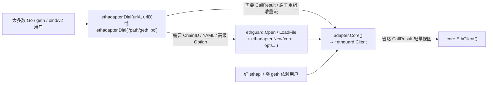

# 用户接入平面、单源语义、IPC 与 `ethadapter` 设计合同

状态：**S0–S6 已实施并通过本地及 PR #13 远端验收**，2026-11-28。修复提交 `3fdb6b7` 的 CodeQL、Linux CI、Windows adapter race 与真实 named pipe 测试全部通过；PR 已以 `7fdda4b` 合入 master。Windows 运行门禁已关闭；beta.4 尚待最终文档提交入远端 master 后执行独立发布门禁，详情见第 8 节。
基线：`refactor/convergence-continuation`（`3e3f353` 之后；S0 `rpcwire.DecodeSubscriptionNotification` 与 WSS 通知版本校验及首次终止者/closing abort 合同已于 2026-11-28 完成验收，随本次提交保存）。
范围：单源初始化与 moving-tag 业务语义、极简 `config` 与端点解析、共享双工传输核、`internal/transport/ipc`、独立公开包 `ethadapter` 与默认订阅策略。

> 本文保留本轮设计与验收范围；长期约束和当前实现已按所有权回写至 [项目路线图](project-roadmap.md)、[代码库拓扑](codebase-topology.md)、[Transport 合同](transport-contract.md)、[Reference 合同](reference-freshness-policy.md)、[订阅合同](subscription-contract.md) 与 [兼容政策](go-ethereum-compatibility-policy.md)。最终证据及未关闭门禁见第 8 节。

---

## 1. 设计总纲与极简用户心智

EthGuard 早期已取消运行期动态增删上游来源的能力，换取了**构造期固定成员、投票期不可操纵**的结构性保证。在此前提下，用户接入平面坚持四条总原则：

1. **单一所有者，两种按需表面**：底层永远只有一个 `*ethguard.Client` 拥有连接池、裁决、固定成员与生命周期；上层提供 `ethadapter.Client`（原生 `go-ethereum` 类型，面向 90% 既有生态与 `bind/v2` 代码）与 `*ethguard.Client` / `*ethguard.EthClient`（`ethapi` 标准模型与完整证据）。
2. **能推导的不让用户填**：`transport` 由 `endpoint` 推导，`id` 省略时自动分配，协议/帧边界/双工多路复用完全隐藏在传输层内部。
3. **行为跟随构造期配置源数，零额外模式开关**：`0` 源报错，`1` 源自动进入 `Forwarded`，`2+` 源自动进入 `Majority`；所有构造入口遵循同一条规则，退役 `DialUncorroborated`。不向用户暴露 `StrictLossless`、`OnReorg` 等选择开关。
4. **安全红线永不松动**：重复端点绝不坍缩、运行期掉源绝不自动降级、单源结果永远诚实标为 `Forwarded`（绝不伪装 `Corroborated`）、坏数据与结构失配一律 fail-closed。



---

## 2. 配置与端点解析（`internal/endpoint` + `config`）

### 2.1 `config` 极简化合同

消除现存 `config.Validate` 放行省略 `transport` 的 WSS、而 `runtime.Compose` 随后拒绝的内部矛盾；**校验入口与装配入口消费同一份规范化解析结果**。

```yaml
# 最简多源 / 混合传输配置：id 与 transport 均可省略
chain_id: 1
upstreams:
  - endpoint: https://rpc-a.example
  - endpoint: wss://rpc-b.example
  - endpoint: /var/run/geth.ipc
```

固定规则（无新增配置旋钮）：

| 项 | 规则 |
|---|---|
| `endpoint` | 必填。经共享 `internal/endpoint` 一次性解析出四元组：`{Kind, Transport, DialTarget, CanonicalID}`。 |
| `transport` | **可选**。省略时按 `endpoint` 自动推导（`http(s)` → `native-http`、`ws(s)` → `wss`、IPC → `ipc`）；显式填写时校验必须与 `endpoint` 类型一致，未知值或错配直接报错。新增常量 `config.TransportIPC Transport = "ipc"`。 |
| `id` | **可选**。显式填写优先保留并校验非空、唯一；省略时按 `rpc-1`、`rpc-2`… 自动填充，**跳过已被显式条目占用的 `rpc-N`**。`id` 仅用于诊断与观测标签，不参与端点去重。 |
| 重复端点 | 一律按 `CanonicalID` 去重并报错，防止拼写变体坍缩导致投票基静默缩水。 |
| `chain_id` | 保持可选且不隐式推导：系统无法从节点响应推导“用户意图连接哪条链”，`chain_id` / `WithChainID` 继续作为有业务意义的配置输入。 |

### 2.2 统一端点解析与 IPC 身份规则（`internal/endpoint`）

新增纯解析内部包 `internal/endpoint`（零网络、零运行时依赖），`config.CanonicalEndpoint` 委托给它，`config` / `pool` / `runtime` / `ipc` 共用同一份结果，彻底消除 `config.CanonicalEndpoint` 与 `pool.normalizeEndpointID` 的双份镜像。

1. **HTTP(S) / WS(S) URL**：保持既有规范化规则不变（小写 scheme/host、剥离默认端口 80/443、去掉孤立 `/`、保留非默认端口与路径、要求非空 host）。**未知协议（如 `ftp://`、`tcp://`）及畸形网络地址（如 `http:/node`、`https:node`、`localhost:8545/path`）一律直接报错，绝不误判成 IPC 路径。**
2. **IPC 输入形态识别顺序**：
   - **Windows Named Pipe**（最先判定，避免被 URL/Unix 路径规则误伤）：`\\.\pipe\<name>`、`//./pipe/<name>`、`ipc://\\.\pipe\<name>`、`ipc:////./pipe/<name>`；`name` 不可为空。规范身份统一为小写 `ipc://\\.\pipe\<lower-name>`（Windows pipe 名称大小写不敏感）；在非 Windows 平台上解析可识别但**拨号期返回明确平台不支持错误**（不在 Linux 上用 `filepath.Abs` 污染 Windows 路径）。
   - **显式 `ipc://` Unix URI**：`ipc:///abs/path/geth.ipc`；拒绝非空 host/authority、非空 query/fragment 或非法百分号编码（显式 fail-closed，不静默丢弃）。
   - **Unix 本地路径**：仅接受明确的绝对路径（`/` 开头，如 `/var/run/geth.ipc`）或显式相对路径（`./` 或 `../` 开头，如 `./geth.ipc`、`../run/geth.ipc`）。**有歧义的裸文件名（如 `geth.ipc`）或无 scheme 网络串（如 `localhost:8545/path`）一律拒绝**，错误提示明确要求写 `./geth.ipc`、`/abs/path` 或带 scheme 的 URL。合法本地路径中的 `#`、`?`、`%` 和空白按字面文件名处理，绝不交由 `url.Parse` 误解。
3. **相对路径基准与冻结时机**：所有入口（`Dial` / `Open` / `FromEndpoints` / `ParseYAML` / `LoadFile` / `New`）中的相对 Unix IPC 路径，均在**配置解析/构造入口层**以当前进程 `cwd` 为基准立即执行 `filepath.Abs` + `filepath.Clean`（不做 `EvalSymlinks`，保持惰性构造允许 socket 尚未创建），将字面绝对路径固化为 `DialTarget`，并以合法 URI 百分号转义形成 `CanonicalID`（`ipc://<escaped-cleaned-abs-path>`）；身份字符串不作为文件名重新拨号。`pool` / `runtime` / `ipc.Dialer` 等后续层只消费已解析结果，不再重新以运行期 `cwd` 解释相对路径。
4. **语义诚实**：路径去重仅保证配置拼写归一，不证明不同 socket 文件或同主机的 WS 与 IPC 指向独立以太坊节点。

---

## 3. 初始化入口与单源语义（方案 X + A1）

### 3.1 统一构造入口（退役 `DialUncorroborated`）

所有构造入口采用同一套源数量规则：**`0` 个端点拒绝；`1` 个端点 → `CorroborationForwarded`（`Floor=0`）；`2+` 个不同端点 → `CorroborationMajority`（`Floor=2`）**。

#### `ethguard` 根包入口

```go
// 1+ 端点零配置构造（惰性；DialContext 的 ctx 仅约束构造入口检查，不成为客户端生命周期 context）
func Dial(endpoints ...string) (*Client, error)
func DialContext(ctx context.Context, endpoints ...string) (*Client, error)

// 1+ 端点 + Go Options（惰性；OpenContext 的 ctx 仅约束构造入口检查，不成为客户端生命周期 context）
func Open(endpoints []string, opts ...Option) (*Client, error)
func OpenContext(ctx context.Context, endpoints []string, opts ...Option) (*Client, error)

// 既有配置入口保持
func New(cfg config.Config, opts ...Option) (*Client, error)
func LoadFile(path string, opts ...Option) (*Client, error)
```

- **退役 `DialUncorroborated`**（项目处于 pre-v1，按 ADR 0065 直接清理，不留废弃别名）。
- `DialContext` / `OpenContext` 保持惰性构造（不发起网络 I/O），仅在入口检查 `ctx.Err()`，传入的 `ctx` **绝不**绑定为客户端生命周期 context（单次调用仍由各自 `ctx` 与 `Client.Close()` 控制）。
- 对应同步更新 `dial_test.go`、相关 facade 测试、README 与 ADR 0030/0065 接续说明。
#### 四条不可妥协的安全红线

1. **重复端点绝不坍缩**：`Dial(a, a)`、`Open([]string{a, a})` 或拼写等价的重复配置一律报错，绝不会静默合并成 1 源进入 `Forwarded`。
2. **运行期绝不降级**：客户端模式在构造期固定，不随可用来源减少而改变；要求 corroboration 的方法保持冻结分母与门槛，运行期即使只剩 1 个存活源也绝不切到 `Forwarded`（多源模式下 Median、Local、pending-local 仍各自遵守既有合同；失败类错误按实际原因返回，不一律等同 `ErrInsufficientSupport`）。
3. **状态永远诚实**：单源客户端 `Client.Mode() == rpc.CorroborationForwarded`；单源成功形成的读取 `Decision` 标为 `rpc.Forwarded`（`IsCorroborated() == false`），本地拒绝或提前失败可不形成 `Decision`，写操作继续使用 `WriteDecision`。
4. **显式多源策略与单源冲突即在构造期拒绝**：在 `ethguard.New` 合并 `Config` 与 `Option` 之后、`runtime.Compose` 中，若 `len(Upstreams) == 1` 且启用了 `WithFinalizedAnchoring`（或 YAML `anchoring.preset: finalized`），**构造期直接返回错误**——防止用户误以为单源具备多源 finalized 锚定保护。单源对 `"finalized"` 标签的普通读取（如 `BlockByNumber(-3)`、`BalanceAt(..., -3)`）不受影响，正常返回诚实的 `Forwarded` 结果。

### 3.2 单源 Moving-Tag 业务 Reference（A1 合同）

修复单源客户端在 `latest`/`safe`/`finalized`/`nil`、`BlockNumber`、`BlockByNumber(nil)`、`HeaderByNumber(nil)`、`EstimateGas`、`FilterLogs(latest)`、`SimulateV1(nil)` 全部报 `ErrGuaranteeNotMet` 的结构性缺陷。

**统一规则（不散落 `if len(sources)==1` 补丁）：**

1. **在 `rpcengine` / `runtime` 建立唯一 reference 可用性判定**，输入为：
   - 调用用途：`ReferencePurposeBusiness`（业务读取内部锚定）vs `ReferencePurposeStandaloneAnchor`（独立 `AnchorBlockHash*` / `AnchorBlockHeight` 查询）；
   - 本次调用冻结的 `Corroboration`（`Mode`/`Floor`）与 `Basis`；
   - 请求的 `tag`。
2. **规则矩阵**：

| 用途 | 冻结模式 | 允许通过的 `ReferenceEvidence.Status` | 不满足时错误 |
|---|---|---|---|
| 业务读取（`ReferenceStage` / `ReadPlan` / 内部 `establishReference`） | `Majority` / `Unanimity` | 仅 `rpc.Corroborated`（**多源失败绝不放宽为 `Forwarded`/`Selected`**） | `ErrInsufficientSupport` / `ErrConflict` / `ErrGuaranteeNotMet` |
| 业务读取（同上） | `Forwarded`（仅单源构造可产生） | `rpc.Forwarded`（须含合法完整 `Hash` + `Height` 且 `EvidenceServesTag` 匹配） | 坏头/缺字段/错 tag/传输失败仍 fail-closed |
| 独立 `AnchorBlockHash` / `AnchorBlockHashForTag` / `AnchorBlockHeight` | 任意 | 仅 `rpc.Corroborated` | 单源继续返回 `ErrGuaranteeNotMet`（保留既有独立 anchor 合同） |

3. **串联覆盖点**：
   - `internal/runtime/reference_service.go`：`headAnchorPolicy` 与 `restoreAnchorSourceValue`（单源 `Forwarded` 同样保留源 wire 拼写并经 `blockRefFromDecision` 提取小写 hash 与 height）；
   - `internal/rpcengine/read_plan.go`：`PrepareWithReference` 接收本次调用冻结的 `Corroboration`（或由 `servingReferenceError` 校验用途与模式），允许单源 `Forwarded` reference 重写 pin；
   - `execution.go` / `block_reads.go`：将独立 `Anchor*` 公开入口与 `BlockByNumber` / `HeaderByNumber` / `BlockNumber` 内部使用的 `establishBusinessReference` 分离，共用同一 `ReferenceStage`，不另起第二套网络建立算法；
   - **单源 `TipTracking`**：显式配置时可保留用于周期健康/RTT 探测，但单源无同侪新鲜度证明，文档明确不以自身样本声称防落后。

---

## 4. 订阅能力声明、共享双工核与 IPC 传输

### 4.1 订阅能力构造期固定（消除 `ws/wss` 硬编码）

- `pool.Member` / `pool.Source` 在构造期由选定的 `Dialer` 不可变地声明订阅能力（例如 `transport.BoundedSubscriberDialer` 标记接口或 `Member.SupportsSubscription bool`），**绝不在构造期为探测能力提前拨号**。
- `Pool.SubscriptionSources()` 按成员不可变能力标记筛选，彻底移除 `url.Parse` + `ws`/`wss` 判别。
- 实际建流时仍检查已拨号 `transport.Transport` 是否实现 `transport.BoundedSubscriber`，声明与实现不符则报错。
- 订阅分母固定于能力来源集合，不受连通性/健康变化影响：
  - `1 HTTP + 1 IPC`（或 `1 HTTP + 1 WSS`）的多源客户端，仅 1 个可订阅来源，严格多源订阅**本地拒绝**；
  - `1 WSS + 1 IPC` 或 `2 IPC` 的多源客户端，2 个可订阅来源进入固定多源订阅 basis；
  - 单源 `IPC` 或单源 `WSS` 客户端，走单源 `Forwarded` 订阅路径。
- 内部哨兵 `pool.ErrNoWSSSource` 迁移为语义准确的 `pool.ErrNoSubscriptionSource`（无外部公开包依赖，随受影响内部调用者一并更新）。

### 4.2 共享双工 JSON-RPC 内核（`internal/transport/streamrpc`）

在已验收的 `rpcwire.DecodeSubscriptionNotification` 基础上，将 `internal/transport/wss/wss.go` 中传输无关的双工 RPC 状态机抽为独立切片 `internal/transport/streamrpc`：

- **职责划分**：
  - `internal/rpcwire`：独占 JSON-RPC 2.0 请求编码、响应校验、协议错误 presence 与 `DecodeSubscriptionNotification`；
  - `internal/transport/streamrpc`：独占 `pending` 表、request-ID demux、`NotificationStream`、有界队列与 `Release` 租约、pre-bind 未知 ID 缓冲与预算、setup 取消清理、graceful `Close` / `drainCloseIfSettled` / `abort` 及 `ChainID`；**严禁 import `wss` 或 `ipc`**，不负责自动重连或重放；
  - `internal/transport/wss`：保留 RFC6455 握手、帧 codec、控制帧与物理 `Conn` + 薄包装；
  - `internal/transport/ipc`：保留平台拨号、有界 JSON 帧扫描器与物理 `Conn` + 薄包装。

- **`MessageConn` 窄接口与可执行所有权合同**：

```go
type MessageConn interface {
    ReadMessage() ([]byte, error)
    WriteMessage(ctx context.Context, payload []byte) (written bool, err error)
    Close() error
}
```

必须由共享核合同测试强制验证的五条不变量：
1. **读缓冲独立所有权**：`ReadMessage` 返回的切片必须与内部读缓冲完全隔离，后续读取不得覆写已交付字节（IPC 绝不可返回 `bufio` 复用切片）。
2. **终态与错误归类**：读失败为粘性终态；`Close` 必须解除阻塞中的读写；超限错误保留中立 `transport.ErrBodyTooLarge` 与 `transport.ErrConnectionClosed`。
3. **写结果精确区分（禁止靠错误字符串猜）**：物理 `Conn` 自己拥有唯一写锁（WSS 控制帧与业务写共享此锁）与有界 `maxWriteWait`（30s）。`WriteMessage` 返回 `(written bool, err error)`，共享核严格按以下真值表处置：

| `(written, err)` | 语义与共享核动作 |
|---|---|
| `(true, nil)` | 完整帧已写出；正常等待对应响应（若是 `eth_subscribe` 且随后建流取消，按 setup 清理合同处理：已取得 ID 则 `eth_unsubscribe`，无法确定 ID 则 `abort` 关闭连接） |
| `(false, ctx.Err())`（确认 0 字节落线，如等待写锁或发送前取消） | 连接仍健康；仅移除本次 pending 并返回取消错误 |
| `(true, err != nil)`（部分写/写中超时/写错） | 流边界可能失步；立即 `abort` 连接并携带 `transport.ErrConnectionClosed` |
| 物理写错误（非 `ctx.Err()`，即使 `written == false`） | 底层 socket/pipe 不可信；立即 `abort` 连接并携带 `transport.ErrConnectionClosed` |
| `(false, nil)` | 非法接口结果；视为内部违约立即 `abort` 连接 |

发送前取消必须返回精确的 `ctx.Err()`；物理写错误保留包装，即使包含 context 哨兵也不能冒充健康取消。实际 socket/pipe 写入被取消期限打断时，即便报告 0 字节，仍按物理错误终止。写入取消回调必须在释放物理写锁前停止或等待完成，防止迟到 deadline 污染下一次写。

4. **生命周期语义保持（区分物理 Close 与优雅 Close）**：
   - `MessageConn.Close()` 为**立即物理关闭**，必须解除任何阻塞中的 `ReadMessage` / `WriteMessage`；
   - `streamrpc.Transport.Close()` 为**优雅排空关闭**：立即拒绝新调用、清空 pre-bind 缓存、停止分发通知、不取消在途 unary 调用，待最后一个 pending 结算后再调用 `MessageConn.Close()`；
   - `abort` 为**立即故障终止**：无论是否处于 graceful closing 期间，真实读写故障仍可触发 `abort`，并保留**首次终止者拥有失败原因**合同（不覆盖首个错误），立即失败全部 pending 与订阅流。
5. **通知队列语义保持**：生产失败 FIFO 排空再交付终态，显式 `Unsubscribe` / `Close` 丢弃未读并等 pump 退出，每条租约 `Release` 恰好一次。

### 4.3 IPC 传输（`internal/transport/ipc`）

1. **平台拨号**：
   - Unix（`//go:build unix`）：Go 标准库 `net.Dialer.DialContext(ctx, "unix", path)`，零第三方依赖。
   - Windows（`//go:build windows`）：通过 `github.com/Microsoft/go-winio`（`winio.DialPipeContext`，已在 `go.mod` 中，仅在 Windows 文件直接引用，**不扩大 WSS 第三方白名单**）。
   - 其他平台：编译通过，拨号返回明确 `ipc: unsupported platform` 错误。
   - **CI 必须补齐真实 Windows Named Pipe 运行测试**（不能仅靠交叉编译 `build/vet` 替代运行验收）。
2. **有界 JSON 顶层值扫描器（Frame Scanner）**：
   - Ethereum IPC 为无长度前缀的流式 JSON-RPC（允许空白/换行分隔、多行格式化 JSON、紧邻对象 `}{`）。
   - 扫描器只做**有界词法边界切分**（跟踪容器嵌套深度、字符串字面量与 `\"`/`\\` 转义、忽略值间空白），**不充当第二套 JSON 语义解析器**（完整协议合法性仍交由 `rpcwire`）：
     - 单条消息累计字节超过 `ReadLimit`（默认 `limits.MaxBodyBytes` = 32 MiB）立即 fail-closed 返回 `ErrBodyTooLarge` + `ErrConnectionClosed` 并 `abort`；
     - 拒绝过深嵌套（对齐 `internal/jsonsafe` 深度上限）、截断 EOF、非法顶层 token；
     - 明确**不支持 JSON-RPC batch**（顶层 `[...]` 不得被放行成批处理）；
     - 单次 `Read` 返回多条粘包消息时，完整保留后续字节供下一次 `ReadMessage` 消费；
     - 缓冲增长有界，交付前拷贝或移交独立切片。
   - 写侧：构造带尾部 `\n` 的发送缓冲（**不修改调用方持有的 `payload` 切片**），受物理写锁与 deadline 保护；短写或部分写失败立即返回 `written=true, err!=nil` 触发 `abort`。
3. **测试范围声明**：未经逐客户端实测，不把 Geth/Anvil 测试证据扩大为所有 execution 客户端（Reth/Erigon/Nethermind 等）的完整兼容保证。

---

## 5. 独立 `ethadapter` 公开包合同

### 5.1 物理包位置与依赖红线

- 公开包路径：`github.com/codermaybe/ethguard/ethadapter`。
- 允许依赖：`ethguard`、`ethapi`、`rpc`、`go-ethereum` 业务类型（`common`、`core/types`、`ethereum`）；转换校验可用 `trie.NewStackTrie` 配合 `types.DeriveSha` 复核内容承诺，使用 `crypto.ValidateSignatureValues` 及 `common/hexutil` 处理签名与编码边界；这些算法／编码依赖逐项进入白名单。完整对齐 `BlockReceipts`/`SimulateV1` 签名所需的 `go-ethereum/rpc.BlockNumberOrHash` 与 `ethclient.SimulateOptions` 仅在 `ethadapter` 精确声明并锁定白名单。
- **硬性隔离（纳入 `architecture_interlock_test.go` 与 Windows 交叉构建检查）**：
  - 核心包（根 `ethguard`、`ethapi`、`rpc`、`config`、`observe`、`internal/*`）**永远禁止 import `ethadapter`**；
  - `ethadapter` **禁止直接 import 本仓库任何 `internal/*` 包**（所有数据经公开 `ethguard` / `ethapi` / `rpc` 消费）；
  - `go list -deps . ./internal/runtime ./ethapi ./internal/transport/wss` 的 link-time gate 保持零 `ethadapter`、零 `ethclient`、零 `bind/v2`（`bind/v2` 接口满足性断言放 `ethadapter` 的 `_test.go`）。

### 5.2 极简公开 API（零选择开关）

```go
package ethadapter

// 构造入口：1+ 端点（惰性；DialContext 的 ctx 仅约束构造入口，不成为生命周期 context）
func Dial(endpoints ...string) (*Client, error)
func DialContext(ctx context.Context, endpoints ...string) (*Client, error)
// 包装已有 *ethguard.Client（YAML、WithChainID、WithFinalizedAnchoring 等配置在 ethguard 侧完成）
func New(core *ethguard.Client, opts ...Option) *Client

// 极简审计选项（仅此 2 项，无 StrictLossless / OnReorg 等模式开关）
func WithLogger(l *slog.Logger) Option
func WithAudit(fn func(context.Context, AuditEvent)) Option // 优先于 WithLogger

// 所有权与生命周期：New(core) 与 Core() 共享同一生命周期，Close() 语义完全一致
func (c *Client) Core() *ethguard.Client
func (c *Client) Close()

// 47 项 go-ethereum v1.17.10 ethclient 业务方法（排除底层 Client() *rpc.Client；S5 落地 44 项非订阅方法，S6 补齐 3 项订阅）
// 满足的生态接口（明确清单，不含 PendingStateEventer 等范围外接口）：
//   - S5：bind/v2.DeployBackend、ethereum.ChainStateReader、
//         ContractCaller、GasEstimator、GasPricer、GasPricer1559、FeeHistoryReader、
//         PendingStateReader、PendingContractCaller、TransactionSender、ChainIDReader、ChainSyncReader
//   - S6：bind/v2.ContractFilterer、bind/v2.ContractBackend、ethereum.LogFilterer、
//         ethereum.ChainReader（含 SubscribeNewHead）、ethereum.TransactionReader（含 SubscribeTransactionReceipts）

// 错误与纯转换辅助
func RevertErrorData(err error) ([]byte, bool) // 仅读取 *ethguard.RevertError，不伪造 code 3
func ToGethHeader(h *ethapi.Header) (*types.Header, ConversionReport, error)
func ToGethBlock(b *ethapi.Block, uncles []*ethapi.Header) (*types.Block, ConversionReport, error)
func ToGethTransaction(tx *ethapi.Transaction) (*types.Transaction, ConversionReport, error)
func ToGethReceipt(r *ethapi.Receipt) (*types.Receipt, ConversionReport, error)
func ToGethLog(l ethapi.Log) (types.Log, ConversionReport, error)
func FromGethCallMsg(msg ethereum.CallMsg) (ethapi.CallMsg, ConversionReport, error)
func FromGethFilterQuery(q ethereum.FilterQuery) (ethapi.FilterQuery, ConversionReport, error)
```

> **对外兼容边界表述**（用于 README 与文档，不夸大等价性）：
> *“常见查询、交易发送与合约调用沿用熟悉的 go-ethereum 接口；多源保证不足、本地拒绝域（如 pending block/logs）与订阅重组通过明确错误交付。”*

### 5.3 转换正确性、Provenance 消费与损失分类

**① 硬拒绝（一律返回错误，绝不降级放行）：**
- 非法定长 hex（Address/Hash/Bloom）、不支持的交易类型，以及**按目标类型及协议字段限制的数值溢出**：`uint64`/`uint` 目标严格检查对应位宽上界，`*big.Int` 目标（如余额、交易 `Value`、gas price/fee、baseFee）保留合法完整任意精度（绝不因超过 `uint64` 而错误拒绝）；负值在无符号字段一律拒绝；
- `Header` 覆盖全部锁定 v1.17.10 字段——包括 `BaseFee`、`WithdrawalsHash`、`BlobGasUsed`、`ExcessBlobGas`、`ParentBeaconRoot`、`RequestsHash`、**`BlockAccessListHash`**、**`SlotNumber`**（缺失保持 `nil`，存在精确还原），转换后**强制复核 `gethHeader.Hash() == ethapiHeader.Hash`**；
- `Transaction` 覆盖 Legacy / 2930 / 1559 / 4844 / 7702（含 EIP-7702 授权列表、EIP-4844 blob hashes/sidecar 语义核对），转换后**强制复核 `gethTx.Hash() == ethapiTx.Hash`**；
- `Block`：
  - **先固化 Block Provenance 消费合同**：在 `rpc` 或公开文档中明确 `Decision.Provenance` 对完整 `eth_getBlockByHash`/`eth_getBlockByNumber(..., true)` 的 JSON 载体格式（经同源准入验证过的 uncle header 数组），**并在消费时复核逐项 uncle hash 与 header 的 `UncleHash`（`types.CalcUncleHash`）**，不把 opaque 字节当免检万能容器；
  - `ethadapter.Client.BlockByHash` / `BlockByNumber` 自动消费本次 `CallResult.Decision.Provenance` 还原完整 `*types.Block`（无需用户开 `WithSourceEvidence`）；
  - 独立 `ToGethBlock(b, uncles)` 当区块 `Uncles` 列表非空但调用方未提供匹配且通过哈希校验的 `uncles` 时，返回 `*ConversionError`，绝不静默构造缺失 uncle 的残缺块。
  - 公开纯转换入口同样复核实际交易列表的 `TxHash`、withdrawals 列表的 `WithdrawalsHash` 及 uncle 内容承诺；仅有自洽的 Header hash 不证明 body 与头匹配。保留合法的历史交易签名接受域，不在缺少链规则时额外假定现代链激活条件。
- `FromGethCallMsg`：拒绝负的 `Value`/`GasPrice`/`GasFeeCap`/`GasTipCap`/`BlobGasFeeCap`；`Data` 映射至 `ethapi.CallMsg.Input`；记录 `Gas == 0` 无法区分“未设置”与“显式 0”的 Go 零值边界（默认按 geth 惯例 `0` 省略）。

**② 两层结果与审计合同（绝不混同、绝不遮蔽）：**

| 通道 | 归属与行为 |
|---|---|
| **外层 `ethguard.WithResult(ctx)`** | `ethadapter` 内部直接调用 `*ethguard.Client` 原生方法直接获取 `CallResult`，**不在同一 context key 上重套 `WithResult`**。外层 capture 永远只记录核心调用的真实结果：若核心成功但 adapter 后置转换失败，外层 capture 仍记录核心成功，adapter 向调用方返回转换错误。 |
| **`ethadapter.WithAudit` / `WithLogger`** | 接收统一 `AuditEvent`（覆盖转换前失败、核心调用结果、转换后省略 `ConversionReport`、转换失败、订阅终态）：明确分开 `CallResult`（核心裁决/证据）、`ConversionReport`（结构性省略清单，如 `*types.Transaction` 不携带 `BlockHash`/`From`）、`AdapterErr`（适配层错误）与 `EvidenceScope`（明确标示当前是否有 `Extensions` / `Uncertain` 可见——Forwarded 模式下 `Extensions == nil` 绝不宣称“已证明无 provider 扩展损失”）。 |
| **未配置审计时** | 零额外 `AuditEvent` 分配与记录开销（诚实声明：不开审计不交付省略报告）。 |
| **观测故障隔离** | 审计回调在业务结果形成后同步/受控调用，记录失败或日志错误不得将已成功的交易广播改写成可重试业务失败；明确定义回调不应长时间阻塞或回调 `Close()`。 |

订阅 setup 阶段使用原始建流 context；event／terminal 审计保留其值，但通过 `context.WithoutCancel` 去掉建流取消、Deadline 与 Cause。只在启用观察时派生该 context，它不替代订阅自己的生命周期。

---

## 6. 默认订阅策略与 `ethadapter` Channel 订阅桥合同

### 6.1 `ethguard` 默认订阅策略（实算验收门禁）

保留手工构造全零 Policy 本地拒绝的安全合同，同时提供透明的推荐预设构造函数：

```go
func DefaultHeadSubscriptionPolicy() HeadSubscriptionPolicy
func DefaultLogsSubscriptionPolicy() LogsSubscriptionPolicy
func DefaultReceiptsSubscriptionPolicy() ReceiptsSubscriptionPolicy
```

**默认值验收约束（已用合成代表性大块负载验证，不代表真实主网采集）：**
- 现行 `internal/subscription` 中 **Head 拓扑与内容（Logs/Receipts）各自拥有独立预算账本**；其中 Logs/Receipts 单次解码工作区预留公式为 `MaxResponseBytes * 256 + 16384`（`logs_subscription.go:333`、`receipts_subscription.go:381`）。在 `ethadapter` 桥接场景下，从 `Next` 接走后的事件与转换对象脱离原生账本，须单独计入桥侧有限资源上限。
- 若直接按 1 MiB 设置 `MaxResponseBytes`，1 个并发槽就需要 > 256 MiB 虚拟额度，极易导致默认策略在真实大区块上直接 `ErrMemoryBudget`。
- 因此本切片落地前必须完成两项核验：
  1. 审计现有 `*256` 预留系数与典型主网区块（含 200+ tx / 500+ logs 区块与完整 receipts）的真实字节大小，给出自洽的默认组合（`Head` 预算与内容预算分别核算，覆盖 `MemoryBytes`、`MaxResponseBytes`、`MaxConcurrentRequests`、`WireMessages`、`WireBytes`、`MaxMessageBytes`、`RequestTimeout`、`RecoveryTimeout`、`RetryDelay`）；
  2. 用合成代表性主网大区块 fixture 跑通连续推进、20 块重组与多源并发测试，证明 `Default*SubscriptionPolicy()` 在零手工调参下可稳定跑通且 `Close()` 后预算归零。

### 6.2 `ethadapter` Channel 订阅桥合同（无 `OnReorg` 开关）

`ethadapter.Client` 的三类订阅直接对齐 `ethclient` 签名（零 Policy 入参，内部复用经实测验收的默认 Policy）：
- `SubscribeNewHead(ctx, ch chan<- *types.Header) (ethereum.Subscription, error)`
- `SubscribeFilterLogs(ctx, q ethereum.FilterQuery, ch chan<- types.Log) (ethereum.Subscription, error)`
- `SubscribeTransactionReceipts(ctx, q *ethereum.TransactionReceiptsQuery, ch chan<- []*types.Receipt) (ethereum.Subscription, error)`

**四条固定行为合同：**
1. **重组终止判定（确定性、无竞态）**：只要底层原生订阅交付的事件包含 `len(Path.Retracted) > 0`（任何已发布路径的撤回，**包括 Logs 的零匹配块撤回**），桥接器立即停止后续推送，关闭底层原生流，并在 `sub.Err()` 上交付包装 `ethguard.ErrReorgDetected` 的终态错误（满足 `errors.Is(err, ethguard.ErrReorgDetected)`）。不依赖“某条事件是否已经被用户从 channel 读走”的竞态判断。
2. **零匹配块与 `PreBirthProof`**：正常推进中的零匹配日志块不向 `ch` 发送伪造的空 `types.Log`，但仍推进内部已发布路径并受重组终止保护；`PreBirthProof` / `Audit` 不伪造为 Header/Log，完整信息归 `Core().Subscribe*` 或审计回调。
3. **有限缓冲、背压与独立终态传播**：桥接器不得在阻塞于 `ch <- item` 时卡死对底层原生流终态的感知。桥内部必须维持**独立于用户 channel 发送的终态/关闭传播路径**（以固定有界转交容量解耦原生读取与用户投递，不新增用户开关，并单独限制桥持有事件与转换对象的内存上界）：当用户永久不读 `ch` 时，无论是底层原生流失败（如 `ErrMemoryBudget`/断连）、`sub.Unsubscribe()`、`adapter.Close()` 还是 `adapter.Core().Close()`，都必须能及时中止发送协程并让终态错误/关闭可靠送达 `sub.Err()`。
4. **生命周期与关闭屏障**：`sub.Unsubscribe()`、`adapter.Close()` 与 `adapter.Core().Close()` 立即解除阻塞在 `ch <- item` 上的发送协程，等待底层原生订阅 `Close()` 完成并关闭 `sub.Err()`，确保无 goroutine 泄漏。建立阶段 `ctx` 仅约束建流；业务方收到 `ErrReorgDetected` 后需自行执行业务侧回滚或回扫（文档明确说明终止订阅不会撤销业务已落库数据）。

终止的线性化边界：首个已经确定的停止原因拥有终态，后到的错误或撤回事实仍可进入事件审计，不覆盖此前原因。与停止竞争、已经开始的一次 channel 发送可能完成；`Err` 关闭、`Unsubscribe` 或客户端 `Close` 返回后，交付任务已退出，不再发送。重组判定始终以原生 Retracted 为准，不依赖 channel 接收时序。

### 6.3 关闭屏障的最小接入边界（S6 实施合同）

仅有 core 的生命周期取消与 pool 关闭不能证明外围 channel 发送协程已经退出。S6 已增加订阅专用的生命周期登记边界，由 `ethadapter` 自动使用；它不是用户配置选项，也不改变订阅建流 context 的作用域。直接创建的原生流不隐式登记，仍通过各自 `Close()` 等待完整清理。

```go
// ethguard 根包：仅用于把外围订阅交付接入同一个关闭屏障。
type SubscriptionLifecycle interface {
    Stop()                 // 幂等、非阻塞；取消建流并解除发送阻塞
    Done() <-chan struct{} // 固定 channel；原生 Close、交付协程退出、Err 关闭均完成后关闭
}
func (c *Client) AttachSubscription(life SubscriptionLifecycle) (detach func(), err error)
```

- 登记与 `Client.Close()` 在同一锁下协调；开始关闭后拒绝新登记。适配器先登记可取消的建流生命周期，再开始原生建流，建流失败同样必须完成 `Done`。
- `Close()` 先封闭登记、取消 owner 并对全部已登记项执行 `Stop()`，再关闭 pool、等待全部 `Done`。调用 `Stop`、等待 `Done` 以及原生 `Close` 均不得持有登记锁；并发重复 `Close()` 共享最终完成屏障。
- `detach` 只在 `Done` 已关闭后移除登记；它不能使尚未结束的交付逃离 core 关闭屏障。实现须覆盖登记／建流／解除登记与 `Close` 的并发测试。
- root 仅依赖上述小接口，永远不引用 `ethadapter`；不把这一需求扩展成通用任务管理器。适配器审计回调不得在被登记的工作中重入 `Close()`，沿用 §5.3 的观测合同。
- 有界交接队列满时须终止订阅并报告资源错误，原生读取不能无限等待发送方腾位。这样即使用户永久不读 channel，终态和停止路径也仍可推进。
- 三类原生订阅增加 `Terminated() <-chan struct{}` 与 `TerminalError() error` 只读观察：信号在 producer 确立终态时关闭，不等待 FIFO 排空或网络清理；错误原因在该信号关闭后稳定，不因 `Next` 消费终态或 `Close` 清理改变。`Next` 原有 FIFO 排空行为与 `Close` 完成屏障保持各自职责。适配器通过该信号独立中断用户发送，不能把原 `EventQueue.Done()` 的排空／abort 信号当作 producer 终态。
- 桥预算必须覆盖移交后的完整事件、转换过程工作区和待发送 geth 对象；固定队列条数不替代字节上界，不先做无界序列化再检查大小。
- 为在原生账本释放前完成目标额度预留，三类原生流增加先进消费者使用的 `NextWithBudget(ctx, destination)`，返回对应事件、幂等 release 与错误；root 只公开订阅专用的 `Reserve(bytes) (release, error)` 小接口／稳定 alias。该 seam 复用现有 Head queue 的移交合同，Logs／Receipts 同样先预留后出队。适配器自动使用它，普通 `Next` 和 geth channel 用户无需配置新选项。reserve 必须非阻塞且不得重入订阅；失败时原生 payload 保持原归属，错误携带的审计与 release 也须保持明确所有权。接收方最终发送、丢弃或失败都释放同一租约恰好一次，转换时源事件与新对象的同时持有分别计入额度。


---

## 7. 实施切片与验收顺序

所有切片沿用架构互锁（P4 随每片同步更新，不提前全局放宽门禁）；实施已按 S0 → S6 顺序完成，以下保留各片验收要求，实际完成范围见第 8 节：

| 顺序 | 切片 | 改动模块 | 核心验收门禁 |
|---|---|---|---|
| **S0** | （已验收）WSS 通知信封校验与终止合同 | `internal/rpcwire`、`internal/transport/wss` | 缺失/非 `"2.0"` `jsonrpc` 或带 `id` 的通知被拒绝；首次终止者拥有失败原因、graceful closing 期间仍允许真实故障 abort；合法通知/预算/取消无回归。 |
| **S1** | 单源业务 Reference 与统一入口（方案 X + A1） | `internal/rpcengine`、`internal/runtime`、root `dial.go`/`client.go`/`execution.go`/`block_reads.go` | `Dial`/`DialContext`/`Open`/`OpenContext` 统一 1+ 端点且保持惰性、退役 `DialUncorroborated`；单源 HTTP/WSS 跑通 `latest`/`safe`/`finalized`/`BlockNumber`/`EstimateGas`/`FilterLogs`；单源 + `WithFinalizedAnchoring` 构造期拒；独立 `Anchor*` 仍要求 `Corroborated`；多源不因可用源减少降级且 Median/Local/pending-local/Write 既有合同不变；重复端点不坍缩。 |
| **S2** | 统一端点解析、极简 `config` 与订阅能力声明 | `internal/endpoint`、`config`、`internal/pool`、`internal/runtime` | YAML 省略 `transport`/`id` 可用且自动 `rpc-N` 跳号；消除 `Validate`/`Compose` 矛盾；IPC 多拼写去重 + 相对路径构造期按 `cwd` 冻结（改 `cwd` 不偏离）；`geth.ipc`/`http:/node`/`https:node`/`localhost:8545/path` 均明确拒绝；`SubscriptionSources` 按构造期不可变能力筛选。 |
| **S3** | 共享双工核抽取 | `internal/transport/streamrpc`、`internal/transport/wss`、依赖互锁 | `MessageConn` 全部 5 条所有权/写结果真值表合同测试通过；S0 首次终止者与 graceful closing 期间真实故障 abort 合同不回归；WSS 全套合同/race/fuzz/互操作零回归；WSS 仍零第三方依赖。 |
| **S4** | IPC 传输实现与装配 | `internal/transport/ipc`（unix/windows）、`internal/runtime`、CI Windows test | Unix 真实 socket + Windows 真实 named pipe 实测通过；有界扫描器覆盖粘包/分片/转义/多行/超限/深嵌套/batch 拒绝/短写 abort；单源 IPC + `WSS+IPC` 混合三类订阅通过；资源与 `Close` 屏障 race 通过。 |
| **S5** | `ethadapter` 非订阅调用、转换中心与审计 | `ethadapter`、Block Provenance 合同、架构互锁 | 44 项非订阅方法（含 `Close`）及对应子接口（`DeployBackend`、`ChainStateReader`、`ContractCaller`、`ContractTransactor` 等）编译与消费测试通过；Header 全字段（含 `BlockAccessListHash`/`SlotNumber`）与 Tx 5 类 hash 复核；大整数 `*big.Int`（>`uint64`）成功且窄字段溢出拒绝；Block 消费 Provenance 还原完整 uncle；缺 uncle/坏数据拒绝；外层 `WithResult` 不被遮蔽；核心包零反向依赖 `ethadapter`/`ethclient`/`bind/v2`。 |
| **S6** | 默认订阅策略实算验收与 `ethadapter` 订阅桥 | root `Default*SubscriptionPolicy`、`ethadapter` 订阅桥 | 代表性主网大块负载下默认 Head/内容预算稳态通过且 `Close` 归零；补齐 3 项订阅、达到 47 项完整方法集并通过 `bind/v2.ContractBackend` 与合约 watch 消费验证；遇原生 `Retracted`（含零匹配块）确定性返回 `ErrReorgDetected`；用户永久不读 `ch` 时原生失败/`Unsubscribe`/`adapter.Close`/`Core().Close` 均可靠终止无泄漏（race 通过）；全仓文档与正式合同同步收口。 |

## 8. 最终本地验收与剩余平台门禁（2026-11-28）

冻结的 841 个 Go／模块／CI 与 lint 输入在最终验证前后无漂移。Go 1.26.11、锁定 geth v1.17.10 下，主控独立运行 `ETHGUARD_REQUIRE_COMPLETE=1 go test -p 2 -json ./... -count=1` 及对应 `-race` 命令，均退出 0：各 59 个测试包、10,433 个测试及子测试通过事件，另 8 包无测试，零失败、零跳过测试。Verification 的 `-race -count=2 -shuffle=on` 复验通过。早先发现问题的验证不计入该最终 PASS。

原生 build／vet、Windows 全包交叉 build／vet、Windows adapter／IPC 测试编译、Plan 9 端点／IPC fallback 构建、默认及 anvil 两路固定版本 lint、anvil 编译、tidy 差异、生成 Go／audit 逐字节对比、actionlint、格式与 diff 检查均通过。固定版本 govulncheck 报告零可达漏洞，另有 7 项仅存在于依赖模块且未进入代码调用路径。anvil 仅编译，未启动真实链。

S6 默认策略直接通过 240 笔交易／720 条日志的大块、连续消费、20 块原子重组及实际双请求并发；关闭后 Head／内容账本归零。抽样保留额度及复现测试入口归[订阅合同](subscription-contract.md#2026-11-28-默认预算与外围桥本地验收)，不将这些数值解释为 heap／RSS 或任意主网负载上限。完整 47 项精确签名、生态接口与 bind/v2 合约 watch、三类撤回终止、未读 channel 的原生终态和全部关闭屏障均已验证。

Windows 真实 named pipe 测试与 Windows race CI 已落地，本环境无法实际运行；该平台门禁继续保持未关闭。没有新增真实 provider 观察、完整 Simulate／F1 保证或正式发布结论。待 Windows CI 提供实际运行证据后，再按平台合同补记结果。

### 独立终审后的边界修复（2026-11-28）

后续审查复现两项遗漏：适配器自有引用转换拒绝合法 `EarliestBlockNumber(-5)`，以及长期订阅的 event／terminal 审计继承已结束的 setup 取消／期限。生产补丁仅涉及 `ethadapter/convert_inputs.go` 与 `ethadapter/subscription.go`：补 `-5 → "0x0"`，仅启用观察时派生一次 `WithoutCancel`，setup 继续使用原 context。没有改变原生执行、策略预算或停止原因优先规则。

独立新增回归先 RED 后 GREEN，覆盖 FilterQuery、FilterLogs、SubscribeFilterLogs、BlockReceipts、SimulateV1 的 earliest 消费，未知／超 int64 负标签拒绝，以及三类审计 context 的值与作用域。另以确定性交错验证 native failure／nil 先确定与 adapter stop 先确定三种顺序，均保留已确定首因；Err 缓冲入队即移交错误所有权，不等待应用 receive，未发现第三个行为缺陷。

补丁冻结后主控执行 `ETHGUARD_REQUIRE_COMPLETE=1 go test -race -count=1 -json ./ethadapter`，208 个测试及子测试通过事件，零失败、零跳过测试，14.101s；固定版本 adapter lint 为 0 issues，vet 和 diff 检查通过。上方 10,433 事件的全仓普通／race记录对应补丁前完整基线；这次补丁由 adapter 整包与独立回归覆盖，没有重跑未修改的全仓。Windows 真实运行门禁保持开放；该补丁随本轮提交本地保存，未推送。

2026-11-28 本地保存：用户已授权将本轮已验收改动提交 Git，不推送。当前 CI 的 push 仅监听 master，另支持 pull_request；功能分支单独 push 不触发该工作流，需创建／更新 PR 或进入 master 后，由 Windows job 提供真实 pipe 运行结果。

### PR #13 首轮远端检查与容量修复（2026-11-28）

用户随后推送 `06c78cd94718d5e835b24ba56088338b4e369dbd` 并创建 PR #13。CI run `46126656746` 的 Linux 全仓测试、Verification race 两次乱序、构建、架构隔离、格式／tidy／vet、lint 与 govulncheck 均通过。PR 按配置跳过 scheduled fuzz／deadcode；CodeRabbit 因变更文件数超过其上限而跳过，不计作独立代码审查。

Windows job `140922906956` 的 build、vet 及 `go test -race ./internal/transport/streamrpc ./internal/transport/ipc` 成功；随后 `go test -race ./ethadapter` 失败，因此显式 `TestWindowsNamedPipe` 步骤被跳过。Windows IPC 整包命令包含该平台的四个真实 pipe 用例，但公开检查结果没有逐例日志；记录整包成功，保留显式 pipe 步骤与 Windows job 整体门禁。用户随后提供失败日志，明确定位到 `TestIndependentAuditSeparatesPreCoreAndPostConversionFailures/pre`：完整审计事件的 `Duration` 为 0，被测试的 `<= 0` 条件拒绝。

独立复核确认生产代码正常在观察启用时调用 `time.Now()`，审计使用 `time.Since(started)`；公开合同不承诺严格正耗时，两个时钟读数相同时零值合法。补丁仅将 `ethadapter/audit_contract_test.go` 的条件改为 `< 0` 并解释时钟粒度，保留恰好一次审计、方法、错误归因与外层 capture 的全部断言，不修改生产计时。临时 Go overlay 将观测耗时固定为零时旧断言 RED、修复后四阶段 GREEN；固定为负值仍 RED。真实代码审计测试 race 连续 10 轮通过；主控 `ETHGUARD_REQUIRE_COMPLETE=1 go test -race -count=1 -json ./ethadapter` 得到 208 个测试及子测试通过事件、零失败／跳过（14.731s），固定版本 lint 为 0 issues。这些结果不代替 Windows runner 重跑。

CodeQL 的 Go／Actions 分析任务执行成功，但汇总检查因三条 `go/allocation-size-overflow` 告警失败：两条指向 `rpcwire.EncodeRequest` 拼接 header、params 前缀与 params 的容量加法，一条指向 IPC `WriteMessage` 的 `len(payload)+1`。修复在每次加法前按 `math.MaxInt` 减法检查剩余空间，越界返回本地错误；不使用入站消息上限代替出站容量证明，不改变编码次序、消息字节、取消／deadline 与写进度合同。

补丁只改这两个生产文件并增加两个纯整数边界测试文件。rpcwire、IPC、streamrpc、HTTP 与 WSS 整包普通／race、相关 lint／vet 及架构依赖门通过。主控以临时 Go overlay 恢复原未检查算式，在 386 实际运行下确定性复现六个边界失败；恢复修复后两组边界测试通过，全程未构造巨型 slice。此记录属于本地修复验收；用户已授权将容量保护、Windows 审计测试修正及验收记录随本次提交保存，未推送，也未获得 GitHub CodeQL 重跑或 Windows adapter 修复后的运行结果。


### PR #13 复验通过与合入 master（2026-11-28）

修复提交 `3fdb6b70e65ba15e036e26d32acad68864f1262b` 的 CI run `46129611512` 已完成：全仓测试、Verification race 两次乱序、构建、架构隔离、格式／tidy／vet、lint、govulncheck 与 release 配置门均通过；CodeQL 汇总检查 `140931785303` 成功，三条容量告警已关闭。scheduled fuzz／deadcode 按触发条件跳过，CodeRabbit 的文件数限制仍不计为代码审查证据。

Windows job `140931942348` 的 build、vet、streamrpc／IPC race、adapter race 及独立 `go test -race ./internal/transport/ipc -run '^TestWindowsNamedPipe' -count=1 -v` 步骤全部成功。此次为真实 Windows runner 运行证据，关闭此前平台门禁；不扩展为所有 execution 客户端的 IPC 互操作保证。

用户于 2026-11-28 合并 PR #13，master 合并提交为 `7fdda4b1a956dc2b370eb56a8a0917fcb941886c`，文件树与已验收的 `3fdb6b7` 相同，保留阶段历史。根目录中英文 README 随 beta.4 准备更新公开入口、示例和保证边界。beta.4 tag 尚未创建；最终文档需推送并完成该 master 提交的 CI，再按发布合同手动启动 `release`，固定最终 SHA，经自动质量和产物校验通过后发布；单维护者流程不再要求第二人审批。本记录不把 PR CI 当作发布工作流已经通过。
