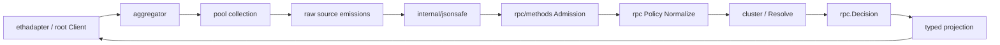

# EthGuard 架构记录

状态：Accepted，2026-09-18

这份记录描述当前实现中稳定的目录边界、数据流和安全职责。它取代阶段性任务清单；后续目录调整应先更新这里，再修改代码。

## 目标

EthGuard 是一个平权多源 Ethereum RPC 客户端。来源按本次调用的固定成员集合计票，不引入 Provider、Region、ClientFamily、FailureDomain 或 Weight 模型。多源一致性是 provider-fault-tolerance 和投毒缓解证据，不是链共识、BFT、canonical membership 或独立 finality 证明。

目录设计优先保持四个概念的 locality：

1. **客户端表面**：构造、生命周期、typed calls 和 ethclient 形状的适配；
2. **来源管理**：连接、健康、采集、freshness 和广播；
3. **通用裁决**：请求、观察、准入、规范化、Quorum 和 Decision；
4. **Ethereum 语义**：方法 wire contract、对象完整性和 Geth 投影。

## 运行时数据流



每个响应遵循：

```text
collect → bounded JSON validation → method admission → method normalization
→ fixed-basis resolution → Decision → typed projection
```

`Decision.Value` 是受保护 Core 的聚合产物：已迁移的数量和成功 DATA 由 Encode 写成规范编码，不跟随代表源拼写；`eth_feeHistory`、`eth_getLogs`、`eth_createAccessList`、`eth_getTransactionReceipt` 和 `eth_getBlockReceipts` 写各自受保护字段的规范对象或数组。其余方法也不得用单一 provider 的“相对可靠值”替代聚合结论。`Decision.Extensions` 只包含达到本次调用动态门槛的非 Core 字段，并绑定到 Core 指纹；未达到门槛或存在多个值的字段进入 `Decision.Diagnostics`，不进入普通返回值。未知或 vendor 字段由 `UncertainCapture` 作为调用级诊断材料保留，不自动提升为 Core。

## 目录职责

### 根包 `ethguard`

根包是 composition root 和高级客户端表面：

- `client.go`：Pool、Aggregator、Policy Registry 和 anchor 的组合；
- `call.go`：通用 Call、typed decode 和对象投影；
- `eth.go`：带 Decision 的高级 typed methods；
- `anchor.go`：公开 reference/anchor surface；
- `write.go`：独立的广播与写入裁决；
- `errors.go`：对外 sentinel aliases；
- `uncertain.go`：调用级不确定数据入口。

根包不承载来源连接细节，也不承载具体 Ethereum wire 字段表。

### `ethadapter`

只负责 ethclient-shaped API 和输入输出形状转换。它必须委托根客户端能力，不得建立第二套 decoder、anchor 或 Quorum 管线。

### `pool`

只负责来源生命周期和采集：长连接、lazy dial、健康、tip/freshness、eligible members、Collect、Forward 和 Broadcast。它不理解 Ethereum 对象字段，也不决定某个 JSON 值是否语义正确。

### `aggregator`

只编排通用流程：Prepare、采集、bounded JSON 检查、AdmissionPolicy、Observation、Policy Resolve 和 Decision evidence。它依赖 `rpc.Policy`/`AdmissionPolicy`，不得导入 `rpc/methods`。

### `rpc`

是通用裁决模型和 transport-facing contract：Request、Observation、Decision、Policy、Corroboration、Strict、Median、Local、Forward、anchor decorators，以及通用错误分类。它不得导入 `rpc/methods`。

### `rpc/methods`

是 Ethereum wire semantics 的唯一归属：

- `eth_*.go`：方法级 request preparation、policy assembly 和方法独有形状；
- `block.go` / `receipt.go` / `transaction.go` / `logs.go`：各对象字段表、
  requiredness、admission 与 commitments（`from` 口径以决策 0051 为准）；
- wire primitive（Quantity/Data/Hash/Address/Bloom）与 spec mask compiler、
  core projection 位于 `rpc/internal/wire` 与 `rpc/internal/objects`，
  不在 `rpc/methods` 下另设 `normalize.go`/`prune.go`；
- `catalog.go`：方法覆盖 inventory。

对象 slice 只为跨方法复用或携带 cryptographic commitment 的对象建立。单方法的 fee history、syncing、access list、call/estimate 和简单 quantity 逻辑留在对应 `eth_*.go`。

### `internal`

- `internal/jsonsafe`：统一 bounded JSON 输入检查；不包含 RPC 或 Ethereum 业务知识；
- `internal/reference`：finalized/common reference 的内部建立机制；
- `internal/refcontext`：一次调用内传播 reference、members 和 corroboration flags；
- `internal/uncertain`：调用级 raw response/field capture；
- `internal/spec`：锁定的 execution-apis 数据、schema 和 vectors；
- `internal/chainlist`：链列表及其测试资料；
- `internal/rpcsample`：采样计划和记录工具。

这些目录都不能成为新的公共 API 层。`internal/reference` 与 `internal/refcontext` 虽然都服务 anchor，但前者建立 reference，后者只传播 invocation state，保持分开。

### `observe`

被动记录 seam。它不能参与安全决策。Prometheus 适配器留在 `observe/prometheus`，不进入核心裁决路径。

### `rpctest`、`cmd`、`examples`

- `rpctest`：HTTP 级脚本化多源测试节点；
- `cmd`：soak 和 rpcsample 等可执行工具；
- `examples`：最小导入示例。

它们不能被核心包反向依赖。

`rpcsample` 是一个例外中的清晰两层结构：`internal/rpcsample` 保存可注入
HTTP client、计划校验、脱敏、记录格式和落盘逻辑；`cmd/rpcsample` 只负责
flag、进程退出码和调用 Collector。它不是运行时 RPC client，也不参与
Quorum、admission 或 compatibility verdict。这个实现有独立的纯内存测试，
因此不应删除或把所有逻辑搬回 `cmd`。`cmd/rpcsample` 的 README、示例计划和
record format 也属于该 CLI 的操作文档，不应混入核心 `docs/design`。

## 清洗和验证边界

当前实现将“清洗”分成三层，不合并成一个万能 normalizer：

1. `internal/jsonsafe`：输入资源和 JSON 语法安全，拒绝重复 key、超深、超大和 trailing data；
2. `rpc/methods`：字段上下文相关的 wire validation、requiredness、请求绑定和 commitment admission；
3. `rpc.Policy.Normalize`：只产生用于 cluster 的比较投影，不修改胜出 raw payload。已迁移标量的 Value 由 Encode 生成，`eth_feeHistory`、`eth_getLogs`、`eth_createAccessList` 和 `eth_getTransactionReceipt` 的 Value 也由 Encode 生成。Normalize 仍不改写原始载荷，也不从比较键反推 Value。

Geth 类型解码是 typed boundary 的投影和第二层校验，不替代 admission。未知 typed object 返回结构化错误，并可通过 `WithUncertain` 读取原始响应，但不得作为普通 Geth 类型继续返回。

## 目录审计结论

README 原有主干目录与实际目录一致，当前不需要大规模移动文件。需要修正的只是目录说明：补充 `internal/jsonsafe`、`internal/reference`、`internal/refcontext`、`internal/uncertain`、`internal/chainlist` 和 `internal/rpcsample`，并把 `docs/design/architecture-record.md` 作为长期设计记录。

暂不做以下重构：

- 不把 `internal/reference` 和 `internal/refcontext` 合并；
- 不把 `rpc/methods` 拆成更多顶层包；
- 不把 `jsonsafe` 移入 `rpc`；
- 不把 root facade、adapter、pool 和 aggregator 合并；
- 不为目录整齐而移动测试文件或 execution-apis data。
- 不删除 `internal/rpcsample` 或 `cmd/rpcsample`；采样工具和运行时客户端保持隔离。

这些移动会降低 locality，或建立第二个看似合理但职责重复的 seam。

## 方法覆盖策略

EthGuard 不以“实现所有 JSON-RPC 方法”为目标。`rpc/methods/catalog.go` 是方法覆盖的唯一 inventory，每个方法必须明确属于以下一种状态：

- `RegisteredMethod`：有方法级 Prepare、Normalize、Admission/语义校验和测试，可进入 Corroborated/Selected 语义；
- `WriteMethod`：走独立广播和相对信任路径，不复用只读 Quorum；
- `UnsupportedMethod`：已知但没有足够安全契约，必须明确写出原因；
- 未注册：透明转发，结果只能是 `Forwarded`，不能被描述为已验证。

继续扩充时按安全价值和语义深度排序，而不是按 RPC 名称数量排序：

1. **优先**：有明确请求绑定且能复用现有对象 slice 的确定性读取，例如按 block/hash 查询交易、交易/uncle 计数和 uncle header；
2. **谨慎**：`eth_getProof` 等带 Merkle proof 的方法。只有实现 proof 验证、请求绑定和失败测试后，才从 Unsupported 提升为 Registered；
3. **暂不提升**：filter 创建/轮询、subscription、账户签名/本地账户管理、debug/trace/admin 和依赖节点本地状态的方法。它们要么有跨调用状态，要么需要不同的信任模型或传输层；
4. **保持独立**：`eth_sendRawTransaction` 等写入方法继续走 WriteMethod，不为了表面覆盖率并入读取策略。

因此，当前目标是让 catalog 对完整方法空间给出诚实分类，而不是让 `rpc/methods` 机械包含所有方法。每新增一个 RegisteredMethod，必须同时提交方法契约、请求/响应 binding、wire normalization、admission 语义和纯内存回归测试。
