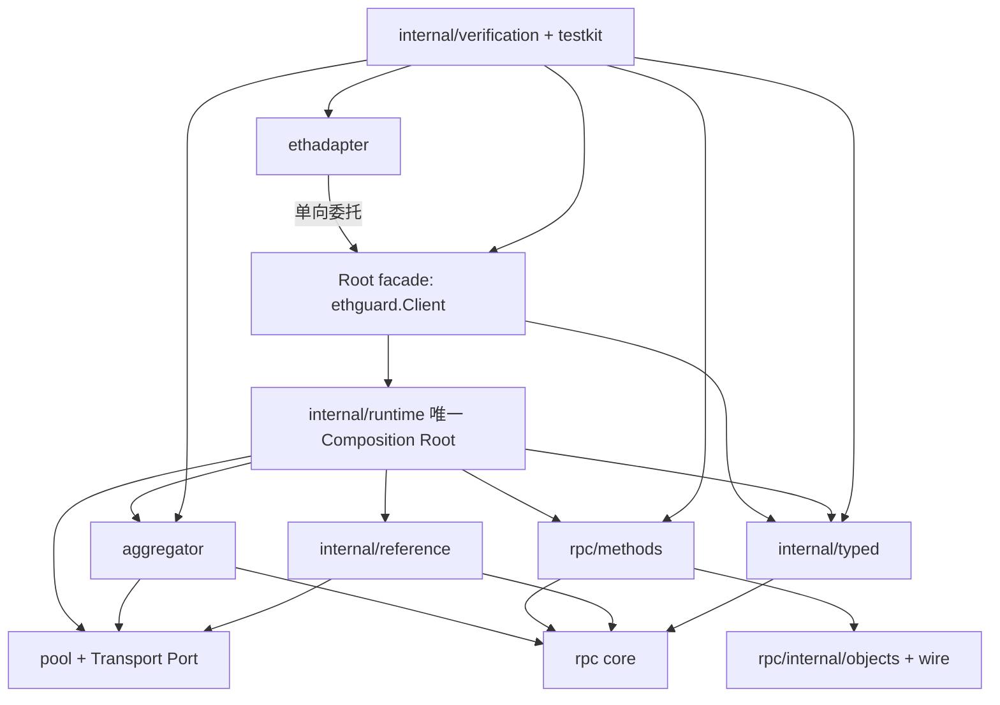

# 代码库拓扑与模块所有权：终审稿

状态：**终审通过，作为结构迁移基线**（2026-10-25）

本文是 EthGuard 代码组织的结构设计稿。它冻结目标目录、Module 所有权、Interface、
Adapter、依赖方向、验证拓扑和未来 seam；不定义文件迁移顺序，不授权生产行为变化，
不改变 quorum、Decision、reference policy 或方法契约。

本文综合了三份拓扑草案：基础模块地图、强化 seam/治理约束、以及 RPC 聚合执行管线。
它保留已经稳定的组织原则，同时把尚未验证的运行时重构降级为后续设计议题。

## 1. 这类设计叫什么

这是一份 **ownership-oriented modular architecture**：以模块所有权为中心的模块化架构。
它同时也是一份 **codebase topology** 和 **module map**：目录不是文件收纳表，而是
人类理解、分工、审阅和定位变更的地图。

它把以下内容固定在一起：

- 哪个 Module 拥有一类知识；
- 哪个 Interface 是 Module 的外部 seam；
- 哪些 Adapter 可以替换实现；
- 哪些依赖方向是允许的；
- 哪些测试代表 Module 的公开验证面；
- 哪些目录可以作为独立工作分配边界。

这份设计使用以下词汇：

- **Depth**：调用方学习的 Interface 很小，但 Module 隐藏了大量行为；
- **Locality**：变更、故障、知识和验证集中在拥有该知识的目录；
- **Leverage**：一个实现通过稳定 seam 服务多个 facade、调用方和测试；
- **Seam**：可以替换行为而无需修改调用位置的 Interface 所在位置；
- **Adapter**：填充 seam 的具体实现，负责外部协议、生命周期或形状转换。

目录本身不是安全边界，也不是 Go 的 package 关键字替代品。真正的设计单位是：

```text
目录中的 Module + 它的 Interface + 它允许的依赖
```

## 2. 设计目标

维护者不阅读整个仓库，也应能回答：

1. 某项行为由哪个 Module 拥有？
2. 调用方通过哪个 Interface 使用它？该 Interface 由谁定义？
3. 替换 transport、typed projection 或 reference 实现时，哪个 Adapter 会变化？
4. 哪些测试验证公开 Interface，哪些测试只验证实现内部？
5. 一个任务应分配给哪个目录，才不会隐式修改其他职责？
6. Composition Root 在哪里？是否存在第二套装配或第二套 decoder？

目标组织保持现有公共 import 路径和产品角色稳定。结构迁移本身不新增 RPC 方法，
不改变裁决门槛、reference policy、Decision 语义或方法数量。

## 3. 目标拓扑

```text
ethguard/
├── client.go / eth.go / call.go / anchor.go / write.go / uncertain.go
│   └── 公共 root facade：公开调用形状、Decision 入口；不持有具体装配细节
│
├── ethadapter/
│   └── ethclient-shaped Adapter：只做调用形状转换，委托 root facade
│
├── config/
│   └── 配置模型、校验和加载
│
├── pool/
│   ├── source.go / collect.go / monitor.go / tip.go
│   │   └── 来源生命周期、成员、健康度、调度和 fan-out
│   └── transport.go
│       └── Transport Port（由 pool 定义）与 HTTP/geth/WSS Adapter
│
├── aggregator/
│   └── 单次调用执行编排：Collect → Admit → Resolve → Decision
│
├── rpc/
│   ├── types.go / policy.go / result.go / ...
│   │   └── 通用 Request、Observation、Decision、Policy 和 evidence 模型
│   ├── projection/
│   │   └── 标准字段投影和 extension Carrier
│   ├── methods/
│   │   └── Ethereum 方法语义、请求绑定、策略装配和方法目录
│   └── internal/
│       ├── wire/
│       │   └── wire normalization、pruning 和规范 primitive
│       ├── objects/
│       │   └── block、receipt、transaction、log、feeHistory 等对象规则
│       └── policy/
│           └── 共用 admission 装饰器
│
├── internal/
│   ├── runtime/
│   │   └── 唯一 Composition Root：装配 pool、aggregator、methods、reference、typed
│   ├── typed/
│   │   └── 唯一生产 typed decoder/projection 实现
│   ├── reference/
│   │   └── reference 建立算法；定义并依赖小型 Head-Reading Port
│   ├── refcontext/
│   │   └── 单次调用内 reference 与成员状态传播
│   ├── testkit/
│   │   └── 共用 fixture、HTTP 节点、区块/交易构造和测试 Adapter
│   ├── verification/
│   │   ├── contracts/      # 方法契约、准入、编码、typed 一致性
│   │   ├── scenarios/      # 决策场景与字段生命周期矩阵
│   │   ├── integration/    # facade + pool + aggregator 联合验证
│   │   └── replay/         # capture/golden 离线回放
│   │       └── 面向公开 seam 的离线验证；生产代码不得导入
│   ├── jsonsafe/
│   ├── uncertain/
│   ├── rpcsample/
│   ├── livecanary/
│   └── ...
│
├── observe/
│   └── 被动事件记录（Recorder）；不参与安全决策
├── rpctest/
├── cmd/
└── examples/
```

这是目标模块地图，不要求所有叶子目录立即创建。目录只有在拥有独立 Interface 或
验证职责时才值得成为新的 package；为了视觉分组而增加浅层转发 package 会降低
Locality。

`rpc/methods` 保持一个生产 Module。当前一方法一入口的文件组织有利于方法语义的
Locality，不因为文件数量增长就按业务名词拆成大量浅层 package。

## 4. Module 所有权

| Module | 所有知识 | 对外 Interface | 不应拥有的知识 |
| --- | --- | --- | --- |
| root facade | 公共 Client 形状、Decision 入口 | root `Client` 方法 | 具体 transport、方法字段表、第二套装配 |
| `ethadapter` | ethclient 调用形状 | ethclient-shaped methods | 第二套 decoder、第二套 quorum、业务裁决 |
| `internal/runtime` | 唯一组合与装配 | root 构造器使用的内部入口 | 公共 API、方法字段语义、请求级执行状态 |
| `pool` | 来源生命周期、健康度、调度和 Transport Port | Pool/Source 与 Transport Port | Ethereum 字段语义、裁决规则 |
| `aggregator` | 单次调用的编排顺序和 evidence 装配 | Aggregate 与 collection Interface | 方法字段、Ethereum schema、具体 transport |
| `rpc` | 通用裁决模型和策略 Interface | Policy、Decision、Observation | 具体 Ethereum 方法知识 |
| `rpc/methods` | 方法请求形态、准入、比较键和策略装配 | 方法 policy constructors、catalog | transport 生命周期、通用 quorum 循环 |
| `rpc/internal/objects` + `wire` | 共享对象字段、编码、承诺和规范化 | 内部 encoder/admission helper | pool、client facade、连接管理 |
| `internal/reference` | reference 建立算法 | reference resolver、Head-Reading Port | 直接构造具体方法 policy |
| `internal/typed` | Decision.Value 到公开 Go 类型的唯一投影 | typed decoder/projection Interface | source collection、投票仲裁、网络传输 |
| `internal/verification` | 公开 seam 的契约、场景、集成和回放验证 | 测试入口与报告 | 被生产代码反向导入、充当生产事实来源 |
| `observe` | 被动事件记录 | Recorder | retry、quorum、安全决策 |
| `cmd` / `examples` | 操作入口与示例 | CLI / example main | 核心业务规则 |

### 4.1 统一硬规则

1. **Interface 由消费者定义**：使用能力的 Module 定义它需要的最小 Interface；实现方
   只需满足该 Interface。
2. **Adapter 纯洁性**：Adapter 只负责外部协议对话、传输/形态校验和格式转换；不做
   admit、quorum、conflict 或其他业务裁决。
3. **单向 facade**：`ethadapter` 只消费 root `ethguard.Client`，不与
   `internal/runtime` 建立平行执行链。
4. **唯一 Composition Root**：全库只有 `internal/runtime` 负责依赖组装；生产代码
   不绕过它建立第二套 Client。
5. **唯一 typed 实现**：root facade 和 `ethadapter` 共享 `internal/typed`，不得各自
   建立 decode 路径。

## 5. 允许的依赖方向



具体规则：

- `rpc` 不导入 `rpc/methods`；
- `rpc` 不拥有网络 I/O；它可以包含与裁决相关的 JSON/wire 表示处理，但不能拥有
  连接生命周期或 HTTP/WSS 传输；
- `aggregator` 只依赖 `rpc` Interface 和来源 collection Interface，不解释方法字段；
- `pool` 不依赖 `rpc/methods`，也不解释 Ethereum 对象；
- Transport Port 由 `pool` 这个消费者定义；HTTP、geth、WSS 是 Adapter；
- `internal/reference` 定义并依赖 Head-Reading Port，不直接构造具体方法 policy；
- `internal/typed` 是唯一生产 typed projection；
- Transport Port 与 Head-Reading Port 不承载方法 policy 组装或业务裁决；这类绑定只允许出现在 `internal/runtime`；
- 生产 Module 不导入 `internal/verification` 或 `testkit`；
- 验证代码可以组合多个公开 Module，但不能成为生产事实来源。

## 6. 验证拓扑

验证代码按“验证哪条公开 seam”组织，而不是按被测源码物理位置组织：

```text
internal/verification/
├── contracts/     # 方法契约、准入、编码、typed 一致性
├── scenarios/     # 决策场景与字段生命周期矩阵
├── integration/   # root facade、ethadapter、pool、aggregator 联合
└── replay/        # capture/golden 离线回放
```

生产 package 内只保留：

- 必须访问未导出实现细节的白盒测试；
- 对一个内部函数或内部状态机的局部 invariant；
- 移出后会制造不合理测试 Adapter 的少量强耦合断言。

其他验证通过公开 Interface 进入 `internal/verification`。这样目录可以区分“实现拥有者”
和“验证拥有者”，测试规模增长时不会淹没生产代码。

长期目录名使用语义名称，例如 `contracts`、`scenarios`、`integration`、`replay`；
任务编号（如 T09）只出现在测试名称、提交和历史记录中，不作为永久拓扑名称。

## 7. 稳定 seam 与运行时管线

### 7.1 Transport seam

`pool` 定义最小 Transport Port。`pool.Source` 不把 `*ethclient.Client` 作为长期
Interface。

最小能力限于：

- 发起一次 JSON-RPC 调用并返回原始响应；
- 关闭连接和释放资源；
- 链 ID 或节点可用性所需的最小读取。

明确排除：filter/subscription 生命周期、geth 具体客户端类型向核心泄漏、供应商私有
客户端类型进入 `rpc` 或 `aggregator`。

HTTP、现有 geth client、未来 raw WSS 都是 Adapter。该 seam 不向 `aggregator`、`rpc`
或 `rpc/methods` 暴露具体 transport 类型。Adapter 不得参与 admit、quorum 或 conflict。

### 7.2 Typed seam

`Decision.Value` 到公开 Go 类型的解码只有一个生产实现，位于 `internal/typed`。

- root facade 可返回 Decision 和证据；
- `ethadapter` 可隐藏证据，只返回 ethclient 形状；
- 两者调用同一 typed implementation；
- 各方法继续保留自己的具体 Go 返回类型，不预先引入泛化 `TypedValue` 公共类型。

### 7.3 Reference seam

reference 建立只依赖由 `internal/reference` 定义的 Head-Reading Port：

- Port 只暴露建立参考点所需的最小 head 信息；
- reference Module 不构造具体方法 policy；
- 方法绑定和策略选择在 `internal/runtime` 完成。

### 7.4 Runtime pipeline（概念模型）

读取类请求的概念顺序是：

```text
Prepare / optional Reference
    → Collect
    → Admit
    → Normalize / Resolve
    → Decision
    → Typed Projection
```

这是执行顺序模型，不是要求所有方法都拥有完全相同的物理路径。移动标签的 reference
由现有方法契约和 reference seam 决定；结构迁移阶段不把 anchoring 重新定义成全局新语义。

## 8. 明确不做的事

- 不新增 `rpc/core` package；现有 `rpc` 继续承担通用裁决模型；
- 不把 `aggregator` 改名为 `engine`；保留现有 Module 名称；
- 不预先引入公共 `TypedValue`；
- 不把“rpc 无网络 I/O”扩大成“rpc 不做 JSON/wire 表示处理”；
- 不把所有 `rpc/methods` 文件按业务名词拆成大量浅层 package；
- 不因目录视觉整齐建立没有行为的转发 package；
- 不把 README、roadmap 或历史决策当作运行时注册表；
- 不规定物理文件迁移顺序；
- 不把目录拓扑重组演变为业务逻辑重构；
- 不引入第二套 Composition Root、第二套 typed decoder 或第二套裁决链路。

## 9. 结构验收标准

结构迁移完成后，维护者应能确认：

1. 每个目录有明确的 Module 所有者和 Interface；Interface 由消费者定义；
2. 生产代码和大规模跨模块验证代码在目录上可区分；
3. root facade、ethadapter、typed decoder 不存在第二套语义实现；
4. `internal/runtime` 是唯一 Composition Root；
5. pool、aggregator、rpc、methods、reference 的依赖方向符合第 5 节；
6. Transport、Typed、Reference 三个 seam 可以替换 Adapter 而无需改调用方；
7. Adapter 不包含业务裁决逻辑；
8. Transport Port 与 Head-Reading Port 不包含方法 policy 组装或业务裁决；
9. 结构提交不改变运行时行为；
10. `go test ./...`、`go vet ./...` 和必要的 race 验证继续通过；
11. CI 有静态依赖守卫，至少覆盖：`rpc` ↛ `rpc/methods`、生产 ↛ `internal/verification`、
    `ethadapter` ↛ `internal/runtime`。

建议的最小可替换性烟雾验证：

- fake Transport Adapter 驱动 pool → aggregator 路径；
- 同一 typed 实现同时服务 root facade 和 ethadapter；
- mock Head-Reading Port 驱动 reference 建立流程。

迁移顺序、具体提交拆分和工具操作另立执行计划，不在本文冻结。
