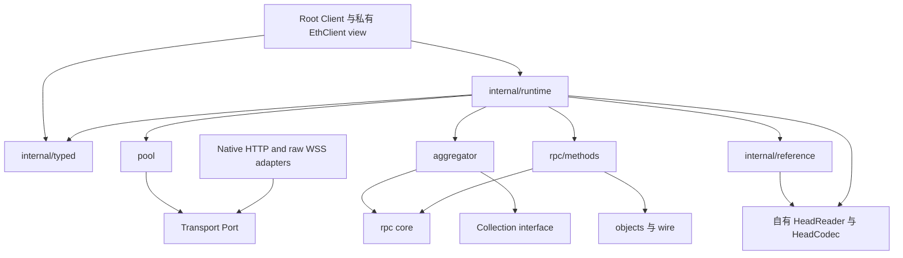

# 代码库拓扑与模块所有权

状态：2026-11-17 文档基线。本文统一定义模块所有权、依赖、ReadPlan／resolver／reference seam 与读取流程；后续目标与未实施改动按路线图推进。

## 1. 模块地图

| Module | 拥有的知识与入口 | 不应拥有 |
| --- | --- | --- |
| root `ethguard.Client`／`EthClient` view | 公共 API、单次 CallResult、捕获与生命周期；共享一个私有执行 owner；Logs编排私有Head、块内容证明和完整批次交付 | 第二套装配、typed decoder 或方法字段表 |
| `internal/runtime` | 唯一生产 Composition Root；pool、aggregator、method、reference、projector 的组装 | 公共 API、第二套业务规则 |
| `pool` | 固定成员、source 生命周期、健康、调度、fan-out，消费 Transport Port | Ethereum 字段含义、裁决公式 |
| `aggregator` | invocation 顺序、reference／业务轮、收集与证据装配 | 具体 transport、字段语义、schema 解释 |
| `rpc` | Request、Response、Observation、Decision、Policy、通用裁决与 evidence | 网络连接、`rpc/methods` 依赖 |
| `rpc/methods` | 请求语义、admission、比较键、encoder 与 reference 需求的装配、catalog | transport 生命周期、另一套 quorum 循环 |
| `rpc/internal/objects`／`wire` | 对象约束、请求绑定、承诺、规范化与字段裁剪 | pool、facade、客户端连接 |
| `internal/reference` | finalized 等候选／确认算法及其 consumer-owned HeadReader／HeadCodec 接口 | 直接依赖 pool、methods 或构造 aggregator／policy |
| `ethapi`／`internal/ethcodec` | 公开 schema 生成业务模型／共享数值和 JSON 原语 | 传输、投票、执行策略 |
| `internal/executionapi` | 固定参考 bundle／显式标准勘误的统一读取与身份检查 | 按来源或调用动态改写 schema、响应兼容或方法注册 |
| `internal/ethobject/{header,receipt,log}` | 查询、订阅事件与同源Pull共享的对象结构／内部完整性及规范编码；不依赖RPC私有包 | 方法装配、请求绑定、投票、网络 |
| `internal/typed` | Value 到公开 Go 类型的唯一生产 projection | source collection、投票、网络取数 |
| `internal/transport` | Port-only 类型、能力与中立 sentinel | 方法 policy、quorum、安全裁决 |
| `internal/transport/{http,wss}` | 原生 HTTP／raw WSS 的协议和保真 | 把 provider 错误重新解释为业务共识；依赖 ethclient |
| `internal/subscription` | NewHead Tip+DAG、连续路径/重组、证人/审计、预算/队列；receipts事件聚合与source/session归属 | 网络I/O、复用unary CallResult假装流式生命周期 |
| `internal/verification`、`internal/testkit`、`rpctest` | 公开 seam 的黑盒、跨模块和 fixture 验证 | 被生产 Module 反向导入或成为生产事实源 |
| `observe` | 被动事件记录 | retry、调度与安全决策 |
| `cmd`／`examples` | 操作入口、捕获与示例 | 独立实现核心规则 |

公共 `gethcompat` 构造与单源 Simulate seam 退出。`internal/testkit/gethoracle` 仅供测试和显式诊断使用，不是生产 runtime；native 执行图不得依赖 `ethclient`。迁移边界见 [兼容政策](go-ethereum-compatibility-policy.md)。

目录必须隐藏实际行为并拥有清楚的 seam；不为视觉分组创建浅层 forwarding package。`rpc/methods` 保持一个生产模块，不因文件数增加就拆成名词包。

### 响应事实与裁定的模块归属（2026-11-21，已验收）

本轮响应结果模型采用通信交换与回答含义两个事实域。`rpc`拥有可交付的中立Response及裁定事实；`internal/transport/{http,wss}`产生实际通信事实，`internal/rpcwire`拥有信封及请求关联；`rpc/methods`及对象模块解释方法内容；`pool`负责调度与健康，`aggregator`编排并消费解释结果，root负责操作组合和交付。Decision与operation不成为新的网络层。

逐源数据使用同一个`rpc.Response`：`pool.Emission`附加Source、Attempted、RTT和同源准入evidence，`rpc.Observation`与reference的`HeadObservation`继续携带它，不复制平面的value/error三元组。`Answer.Interpretation`记录方法准入、完成验证、拒绝、局部候选排除或内部失败；它不重写Exchange，也不删除原Answer.Kind与载荷。候选高度不适用属于局部排除，不能伪造来源未回答。错误投影和候选资格读取集中在Response；下游不从error反向重建协议答案。

接口统一为`Policy.Resolve → Outcome`，声明跨源能力的resolver通过`ResolveCorroborated → Outcome`消费固定snapshot。Outcome拥有本次解释形成的方法判断及来源关系；输入Observation继续拥有通信及协议事实。公开`SourceSummary`把两者投影为Exchange、Answer摘要与Relation，不保留另一份完整result。健康与事件只消费这些判断，不能再次Normalize或CanonicalOf。canonical resolver仍因输入是已处理结果而保留独立入口，它不是可选Outcome旁路。

`rpc/response.go`拥有两层事实及其合法性检查；`rpc/outcome.go`拥有逐源判断及来源摘要；`rpc/adjudicate.go`拥有候选分组和裁定原因；`rpc/write.go`拥有传播及本地交易hash绑定。root的`call_result.go`、`write.go`与`result_capture.go`分别拥有操作结果、同步等待状态和复制交付。保持现有包边界，不因字段变多新建结果管理或分层管理包。

用户确认无兼容负担，允许直接替换旧接口和结果表示；全部消费者与测试在同一专题迁移，旧出口与临时转换必须删除后才能验收。文件继续按实际业务职责组织，不建立浅层分组包或平行V2实现。详细执行合同在现有module-simplification总纲及ethguard模块记录中维护；整体迁移已通过全仓验收，订阅生命周期专题保持独立。

### 方法自治组织

全部注册读方法采用同一组织：每个方法文件拥有自己的 RPC 名称、公开业务接口映射、现有 MethodSpec／只读 MethodDescriptor，以及方法特定的准备、完整 key 修正规则与请求绑定。公开 Go 签名仍在 root／EthClient；一个底层 RPC 策略可服务多个公开入口，不为目录整齐复制策略。

`spec_inventory.go` 与 catalog 对全部方法只收集其所属文件给出的定义，不再次展开配置；集中方法名称表已退役，每个 RPC 拼写由其方法文件唯一声明。方法之间不得调用对方的准备／修正函数；共用对象校验和编码依赖相应 objects／ethobject，通用 codec 依赖 wire／ethcodec。按方法的白盒测试随同名文件，跨方法输出一致性与公开路径测试仍按既有验证 owner 保留。

该布局说明当前知识归属；本轮文档组织不增删公开接口、方法集合或兼容规则，不改变 quorum、保护域或证据合同。后续模块优化可以重选内部接口和表示，但须依据明确目标及行为验收，不借组织整理移除能力。

已确认的规则组织为**外层按官方直接 key 分支，内层按该 key 的完整形态／状态分支**。方法文件拥有经审核的整 key 兼容转换和方法接受域；wire／ethcodec 拥有通用原语和来源驱动的投影；ethapi 拥有生成结构约束；objects 拥有共享对象一致性和规范编码；Header／Receipt／Log跨查询与订阅的共同内核位于root internal/ethobject，RPC对象包保留方法绑定与必要转发，typed只作类型投影，不复制内核检查。内层状态判断不授权嵌套路径或数组元素局部修正，不构成组合注册表；无额外兼容规则的方法不需要空 switch。

状态判定读取原始同源只读上下文，修正写入独立候选；缺失规则与已有 key 去重，每个 key 只处理一次。未命中修正仍须完整校验、编码和比较。当前 PruneMethod 还包含 hex 规范化，消除职责重叠须检查实际实现，不能仅修改归属描述。两 transaction 方法已完成双 switch 收敛，全部方法已按本节自治组织。

## 2. 依赖与稳定 seam



箭头表示依赖能力或契约，不授权 reference 直接 import pool。生产 `PoolHeadReader`、`MethodHeadCodec`、`ReferenceStage` 与 head services 由 runtime 绑定；root anchor facade 不再自己构造 policy／aggregator。一次移动标签读取只有一个 Invocation 和冻结 Basis，不嵌套启动另一轮顶层 Aggregate。

硬规则：

1. Interface 由消费者定义；Transport／Head-Reading Port 不携带方法 policy 装配。
2. Adapter 负责协议、传输形状和生命周期，不做 admit、quorum、conflict。
3. `rpc` 不导入 `rpc/methods`，不拥有网络 I/O；允许裁决所需的 JSON／wire 处理。canonical 处理 seam 属于 rpc core（`rpc/canonical.go` 的类型与 sentinel）与 aggregator（invocation 私有的路线冻结与每源处理阶段）；方法 processor 属于各自方法文件，经 MethodSpec/ReadPlan 声明装配——rpc 不解释字段，aggregator 不解释 schema，plan 是唯一通道，无第二份注册维度（合同见下文“Canonical 单源处理路线”）。
4. pool 不解释 Ethereum 方法参数；aggregator 不解释字段表；生产不导入 verification／testkit。
5. 只有一个 Composition Root 和一个 typed 实现。root 与官方形状 view 不得各自实现一套执行、重试、解析或证据链。
6. geth 的具体 client／rpc 依赖按显式 adapter 与现有静态 interlock 白名单管理；不能从兼容逃生舱推导默认原生 build 已解除限制。

## 3. 单次读取与阶段所有权

一个逻辑调用拥有一个 Invocation 和冻结 Basis。reference 与业务轮共享该身份，不嵌套 Aggregate；成员故障、gate 或准入拒绝均不缩小分母。

```text
ApplyReferenceDefault → Prepare／本地拒绝
  → ReferenceRequirement → ReferenceStage（需要时）→ PrepareWithReference
  → FreezeParams／冻结处理路线 → Collect → JSON 安全检查
  → raw Admit 或 CanonicalProcessor
  → Resolve Outcome → 原始观察的投影／证据／健康最终记账 → typed projection
```

`MethodSpec.Prepare` 与编译后的 `ReadPlan.Prepare` 共用 `func(context.Context, Request) (Request, error)`。coordinator 消费返回请求并拒绝 Method 改名；方法不能原地改调用者参数。Simulate 先快照输入并经生成模型检查，reference 后的最终 wire 冻结只消费库持有值；输入快照和最终请求冻结是两个阶段，不能称为只编码一次。

Prepared 参数与实际 fan-out 同字节。准入把冻结 JSON 解码成只读语义请求，数字保留 `json.Number`，同一请求供各来源共享；调用者 marshaler 不能让网络和准入看到不同 fullTx 或数量。reference 失败不发业务请求。`AdmissionCaller` 是 invocation/source 级依赖，由 coordinator 注入，不能放入静态 spec 或让 resolver 执行网络。

### Reference 声明

`ReferenceSpec` 的 `Kind` 表达 none／hash-at／height-at／height-fields-at；`Positions` 是字符串参数位置，`ParamPos` 与 `Fields` 是对象高度字段，`EIP1898` 表示同一位置的对象形态。requirement 和 rewrite 来自同一声明，不再独立猜测。level 来自请求；safe/finalized 不复用 latest evidence。字段缺省、mixed tags、显式 pin、pending 和 requireCanonical 的逐方法行为见 [引用矩阵](moving-tag-matrix.md)。

ReferenceStage 通过 runtime 绑定的 HeadReader／HeadCodec 与 Transport Port 工作；resolver 不读取 URL、不持有连接、不建立 reference。每次 invocation 重新建立，无跨调用缓存。空 head 仍按既有 normalize fault／ErrNoValidResponse 分类；不得在文档整理中改写错误类别。

### Resolver 能力

| 类别 | 现行能力与语义 |
| --- | --- |
| Strict | 普通与 corroborated Outcome；显式 KeySource；可声明 RPC error body 和 canonical 消费能力 |
| Block | 包装 Strict，提供对应 Outcome／agreement 能力并绑定 by-hash/by-number；当前业务计划以 canonical bytes 聚类；reference HeadCodec 另用 number/hash 身份 |
| CallRevert | execution 与 data 独立裁决，共享 Outcome 内核；data 弃权不冒充 Reject；provider 文案只是上下文 |
| Median／Local | 强制返回逐源Outcome；普通解析与编码，Selected 封顶；有 corroboration snapshot 也不获得 agreement |
| Forward／pending-local | 强制返回逐源Outcome；只判断实际处理的来源，后续来源保持未评估，不推导跨源一致 |

裁定的Required由实际执行的resolver合同形成：有snapshot的入口消费冻结配置，无snapshot的入口保留构造器或默认规则。coordinator核对输入与冻结成员一致，不能在Validate之后覆写Required，或靠覆盖Basis修补不一致。

Outcome是Policy本身的强制合同，不是额外的可选能力。编译对resolver kind、实际Go能力、agreement、KeySource与processor配对双向校验，失败不注册；运行时仍对外部装配的能力矛盾和Outcome覆盖矛盾返回内部合同错误。KeySource 不从 encoder 是否存在推断；normalizer+encoder 可表达窄键与较宽值，具体装配见生成索引。block wrapper 当前直接委托结果，不再恢复代表源原始 spelling。head 身份、full/header/null、请求绑定和 body 承诺分别验证。

### Canonical 单源处理路线

`CanonicalProcessor` 接收冻结语义请求、来源原文与同源 caller，返回不可变 `CanonicalResult`。结果只带 canonical JSON 与可选准入 evidence；不带来源、请求或跨调用缓存。合法 null 是非空的 `"null"`，零 result 表示无成功结果，getter 返回副本。

处理路线在 prepare 末尾冻结一次：plan 声明 processor 且普通 strict 轮走 canonical；pending-local 与 Forwarded 保持 raw 路线。准入、resolve、fault/event 和 health 共同消费这个事实，不重复判断。当前生产接入为两个独立 transaction 查询和 `eth_getTransactionReceipt`。

- 每可用来源执行一次 processor；canonical resolver 直接消费结果，不重跑 raw normalizer/encoder，不在失败后重试或回退。
- 失败来源保留槽位且无结果；成功必须有结果。非法 JSON、错误的槽位配对、成功缺结果、非零 result+error 是 `ErrInvalidCanonicalResult`，整轮失败，不能归罪 provider。
- 内部合同错误不新增来源失败、连续失败或来源错误；确实完成的 transport 成功和延迟仍由 finalizer 记账一次，不跳过 finalizer。
- 方法处理失败保持 `admission: %w` 归因、同源依赖捕获和并发槽位语义。raw 路线的 encode/normalize 故障阶段保持原合同。
- 两路共用聚类、排序、裁定、verdict 与提交内核；raw finish 保留 encoder 声明门，canonical 直接提交已验证结果。
- 编译目前只允许 Strict + canonical-bytes + canonical 消费能力；保留 raw Normalize／Encode／原 Admit。Block、CallRevert、Median、Local 不直接套用此 seam；无 Admit 方法不能凭空补空 hook 改写错误阶段。

## 4. 后续整体优化的设计标准

当前模块划分是基线。文档阶段先完整说明有效合同、实际实现和差距，保存独立 Git 版本，再实施代码优化。允许重选内部表示、状态和接口；有外部影响的合同变化单独说明，不能把历史实现安排当永久要求，也不能借重写静默改变保证。

先审查 aggregator 的 invocation 状态、阶段结果、fault／health／材料和所有退出路径，再沿调用链逐模块处理。接口应隐藏业务复杂性，减少调用方必须同时掌握的规则；拆包、删除适配器或减少行数不能单独证明改进。实现验收通过真实模块接口，并保留独立反例。

架构 interlock、默认 build 依赖、能力互锁及公开调用链共同验证结构。[方法合同](method-contracts.md)拥有业务保证，[返回值合同](return-value-design.md)拥有结果交付，[验证合同](method-verification-pipeline.md)拥有测试与证据要求。
