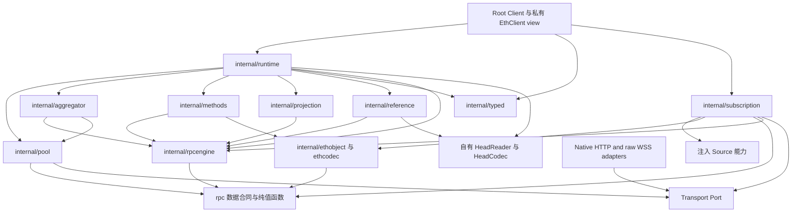

# 代码库拓扑与模块所有权

状态：2026-11-27 对象单树、编码生成、内部执行引擎、订阅 owner、根门面业务归组及诊断目录已收敛。本文统一定义模块所有权、依赖、ReadPlan／resolver／reference seam 与读取流程；后续目标与未实施改动按路线图推进。

## 1. 模块地图

| Module | 拥有的知识与入口 | 不应拥有 |
| --- | --- | --- |
| root `ethguard.Client`／`EthClient` view | 按业务组织的公共 API、单次 CallResult、捕获与 Client 生命周期；Sources／Sample诊断值；订阅入口注入固定来源能力并公开 owner 的稳定类型 alias | 第二套装配、typed decoder、方法字段表或公开pool执行句柄 |
| `internal/runtime` | 唯一生产 Composition Root；pool、aggregator、method、reference、projector 的组装 | 公共 API、第二套业务规则 |
| `internal/pool` | 固定成员、source 生命周期、健康、调度、fan-out，消费 Transport Port | Ethereum 字段含义、裁决公式 |
| `internal/aggregator` | invocation 顺序、reference／业务轮、收集与证据装配 | 具体 transport、字段语义、schema 解释 |
| `rpc` | 公开 Request、Response、Observation、Decision、来源摘要与 evidence 数据合同，以及纯值辅助函数 | Resolver、执行编排、裁决算法、内部执行包依赖 |
| `internal/rpcengine` | Resolver、ReadPlan、Invocation／Basis、canonical 处理、Outcome、裁决与写传播算法 | 网络连接、对象字段语义、methods／aggregator／pool／runtime 反依赖 |
| `internal/projection` | 官方字段投影的装配与覆盖索引 | 来源收集、裁决循环 |
| `internal/methods` | 请求语义、admission、比较键、encoder 与 reference 需求的装配、catalog | transport 生命周期、另一套 quorum 循环 |
| `internal/reference` | finalized 等候选／确认算法及其 consumer-owned HeadReader／HeadCodec 接口 | 直接依赖 pool、methods、aggregator 或 runtime |
| `ethapi`／`internal/ethcodec` | 公开 schema 生成业务模型／共享数值和 JSON 原语 | 传输、投票、执行策略 |
| `internal/executionapi` | 固定参考 bundle／显式标准勘误的统一读取与身份检查 | 按来源或调用动态改写 schema、响应兼容或方法注册 |
| `internal/ethobject/{header,block,transaction,receipt,log,accesslist,feehistory,syncing}` | 唯一对象树：结构、显式投影、规范编码、内容承诺与请求绑定；查询和订阅共用相应内核，可消费 rpc 数据合同 | rpcengine、methods、aggregator、pool、runtime、subscription、facade 反依赖及投票 |
| `internal/ethobject/wiremask` | 有效 schema 的比较字段 mask、剪枝与既有 hex 规范化；供仍使用此比较合同的对象及方法消费 | 方法装配、投票、网络 |
| `internal/wiregen` | 离线 schema 编译、模型及 audit 生成；生成器测试与生产生成命令 | 运行期执行与 provider 接纳政策 |
| `internal/ethobject/hexcompat` | BlockBody／Transaction／SimulateResult的有限已知字段拼写兼容及明确嵌套投影，字段形态取自生成模型 | 通用规则注册、任意未知字段遍历、schema校验、业务派生或承诺 |
| `internal/typed` | Value 到公开 Go 类型的唯一生产 projection | source collection、投票、网络取数 |
| `internal/diag/{livecanary,shapeprobe,rpcsample,chainlist}` | canary、形态探测、采集／回放、registry读取及各自fixture；消费核心能力 | 被核心生产包反向导入、独立实现核心规则 |
| `internal/transport` | Port-only 类型、能力与中立 sentinel | 方法 policy、quorum、安全裁决 |
| `internal/transport/{http,wss}` | 原生 HTTP／raw WSS 的协议和保真 | 把 provider 错误重新解释为业务共识；依赖 ethclient |
| `internal/rpcwire` | 两种原生adapter共用的JSON-RPC信封、请求ID关联与协议错误保真 | 方法解释、来源健康与裁决 |
| `internal/subscription` | Head/Logs/Receipts 状态机、Tip+DAG、连续路径/重组、过滤与内容证明、worker/恢复、证人/审计、预算/队列与source/session归属；通过注入能力编排 | 连接实现、pool/runtime/methods 具体依赖、第二套内容投票器、复用unary CallResult假装流式生命周期 |
| `internal/uncertain` | invocation采集材料、保留预算与截断事实；实现执行入口要求的capture能力 | 方法裁决、source连接与对rpcengine的反依赖 |
| `internal/jsonsafe`／`internal/limits` | JSON结构与资源安全检查／共享响应大小边界 | Ethereum方法字段规则、执行编排 |
| `internal/verification`、`internal/testkit`、`rpctest` | 公开 seam 的黑盒、跨模块和 fixture 验证 | 被生产 Module 反向导入或成为生产事实源 |
| `config` | 公开配置数据、装载及本地校验 | runtime装配与网络连接 |
| `observe` | 被动事件记录与公开HealthSnapshot值 | retry、调度与安全决策 |
| `cmd`／`examples` | 操作入口、捕获与示例 | 独立实现核心规则 |

### 根门面与公开边界

根读取按业务归组：`state_reads.go`拥有身份、账户状态与节点状态；`block_reads.go`拥有block、header与height；`transaction_reads.go`拥有交易、receipt与log查询；`contract_execution.go`拥有call、revert、gas、fee与access-list；`simulate.go`拥有模拟。`read_helpers.go`只集中共享typed读与输入校验；`ethclient_view.go`集中全部view方法，直接调用同一私有实现。`blockAt`与`headerAt`保留各自投影、绑定及错误合同，不通过泛型回调合并。

公开SDK由Client/view、ethapi业务模型、rpc数据合同、config、observe及订阅稳定类型组成。`rpc`不暴露执行计划、resolver或裁决实现。原公开pool／aggregator／rpc方法和投影执行包已移入各自internal owner，无旧路径alias或forwarder；Client.Pool()已退出，诊断使用Sources值快照与Sample原始采样，不能获取pool/source执行能力。root订阅文件只保留稳定alias及入口适配，Head／Logs／Receipts实现均属于internal/subscription。

`internal/diag`集中livecanary、shapeprobe、rpcsample/replay与chainlist，连同各自活动fixture一起归属。诊断消费核心，核心生产包禁止导入整个diag树；命令、rpctest、testkit和公开验证各留在原有边界。归档decisions与samples保留其历史provenance，不随代码路径迁移改写记录。

公共 `gethcompat` 构造与单源 Simulate seam 退出。`internal/testkit/gethoracle` 仅供测试和显式诊断使用，不是生产 runtime；native 执行图不得依赖 `ethclient`。迁移边界见 [兼容政策](go-ethereum-compatibility-policy.md)。

完整块的对象 owner 同时供方法准入、订阅内容证明和 direct raw 解码使用。`block.AdmitBlock` 保留通过完整 shape 编码与承诺检查的 `FullBlock`；方法只复制叔块证据，订阅按需从保留的规范块解析交易，不再经方法 catalog 绕行或对原文执行第二次 Encode。原始字段证据与同源叔块调用保持原顺序。`block.DecodeWithEvidence` 共用该对象的 header/body 投影与生成构造，保留 direct raw 的 header/hash、payload、空非空根及叔块证据检查；它不证明完整交易 trie。typed 只做公开值交付、NotFound 与错误映射，已准入的 Block 仍仅检查生成形态，不重新要求已从 Value 剔除的叔块 bodies。

目录必须隐藏实际行为并拥有清楚的 seam；不为视觉分组创建浅层 forwarding package。`internal/methods` 保持一个生产模块，不因文件数增加就拆成名词包。

根层直接消费 `runtime.ReferenceService.Reference/ReferenceForTag`，从建立证据派生公开 hash／height 与 CallResult。runtime 不保留 Anchor 转发 facade、四方法 resolver 接口或按 preset 分裂的相同服务。单个服务持有共享 ReferenceStage 与构造规则；Compose 对默认 preset 传入 client 规则，对 finalized preset 的独立查询固定 Majority／Floor=2。候选、确认、tag 路由及失败的部分证据仍由既有 stage／reference owner 形成。

`internal/subscription` 是三种订阅的唯一执行 owner，root 只保留公开入口/类型和 Client 生命周期适配。该 owner 通过注入能力编排，不拥有连接实现；固定成员快照回调保持查询/策略验证与成员获取的既有顺序，Source 的订阅、unary 与真实 Response 能力由调用方提供。Logs与Receipts的私有`contentSubscription[E]`只共用typed FIFO、版本提交、预算、请求登记、租约、窗口审计和关闭完成屏障；泛型参数仅表示交付值。各方法保留具体内容准备、过滤、证明、重试和公开事件。Receipts使用`internal/rpcengine.CanonicalOutcomeResolver`固定成员裁定，`pool.Source.Call`保留真实Response，`CallContext`只作投影；不新增通用pipeline或另一套Q算法。旧收据channel、事件Aggregator、Pull探测及累计票据预算已从工作区移除，最终方法验收状态见路线图。

Head主锁串行拥有来源会话准入/退休、路径状态和停止；每个runSource唯一拥有inner及锁外退订，生产机会耗尽与wg实际退出分开。reapWork只等待实际工作再释放工作资源，owner watcher独立保护未消费队列，并由各订阅Close单独等待。锁方向为Head→queue/gate/budget、content→budget；网络、等待和Estimate位于主锁外，不引入Head/content嵌套锁。Client.Close保留owner取消及Pool自身关闭义务，订阅Close提供各自完成屏障，不新增通用生命周期管理器。

### 响应事实与裁定的模块归属（2026-11-21，已验收）

公开诊断只通过 `Client.Sources()` 的 `SourceSnapshot{Source rpc.SourceRef, Health observe.HealthSnapshot}` 值快照与 `Client.Sample(ctx, method, params...)` 原始采样进入。`HealthSnapshot` 的定义属于 `observe`，pool 只生产该数据。`Sample` 复用 client lifecycle、单次参数冻结及 Collect 的来源顺序、eligibility/健康和默认 latest-tip gate，使用 client collect timeout；完整返回 `rpc.Observation.Response` 与 Attempted/Source，Evidence 为空，不做 reference、admit 或裁决，也不经过限额 capture。收集错误与已有 observation 一同返回；响应可变字节由调用方独占。soak 的 deep-dive 保持第二轮真实请求与 Normalize 聚类。公开 API 不暴露 pool/source 执行句柄；pool 唯一生产工厂为 `NewWithMembers`。

本轮响应结果模型采用通信交换与回答含义两个事实域。`rpc`拥有可交付的中立Response及裁定事实；`internal/transport/{http,wss}`产生实际通信事实，`internal/rpcwire`拥有信封及请求关联；`internal/methods`及对象模块解释方法内容；`internal/pool`负责调度与健康，`internal/aggregator`编排并消费解释结果，root负责操作组合和交付。Decision与operation不成为新的网络层。

逐源数据使用同一个`rpc.Response`：`pool.Emission`附加Source、Attempted、RTT和同源准入evidence，`rpc.Observation`与reference的`HeadObservation`继续携带它，不复制平面的value/error三元组。`Answer.Interpretation`记录方法准入、完成验证、拒绝、局部候选排除或内部失败；它不重写Exchange，也不删除原Answer.Kind与载荷。候选高度不适用属于局部排除，不能伪造来源未回答。错误投影和候选资格读取集中在Response；下游不从error反向重建协议答案。

内部执行接口统一为`rpcengine.Resolver.Resolve → rpcengine.Outcome`，声明跨源能力的resolver通过`ResolveCorroborated → Outcome`消费冻结Basis中的构造规则。Outcome拥有本次解释形成的方法判断及来源关系；输入Observation继续拥有通信及协议事实。公开`SourceSummary`把两者投影为Exchange、Answer摘要与Relation，不保留另一份完整result。健康与事件只消费这些判断，不能再次Normalize或CanonicalOf。canonical resolver仍因输入是已处理结果而保留独立入口，它不是可选Outcome旁路。

`rpc/response.go`拥有两层事实及其合法性检查，`rpc/sources.go`拥有公开来源摘要，`rpc/adjudication.go`与`rpc/write.go`拥有可交付的裁定及写入数据。`internal/rpcengine/outcome.go`拥有逐源判断与摘要投影，`internal/rpcengine/adjudicate.go`拥有候选分组及裁定算法，`internal/rpcengine/write.go`拥有传播裁定及本地交易hash绑定。root的`call_result.go`、`write.go`与`result_capture.go`分别拥有操作结果、同步等待状态和复制交付。公开数据合同不导入执行引擎；内部算法直接消费这些合同，不保留旧路径的别名或转发入口。

用户确认无兼容负担，允许直接替换旧接口和结果表示；全部消费者与测试在同一专题迁移，旧出口与临时转换必须删除后才能验收。文件继续按实际业务职责组织，不建立浅层分组包或平行V2实现。详细执行合同在现有module-simplification总纲及ethguard模块记录中维护；整体迁移已通过全仓验收，订阅生命周期专题保持独立。

### 方法自治组织

全部注册读方法采用同一组织：每个方法文件拥有自己的 RPC 名称、公开业务接口映射、现有 MethodSpec／只读 MethodDescriptor，以及方法特定的准备、完整 key 修正规则与请求绑定。公开 Go 签名仍在 root／EthClient；一个底层 RPC 策略可服务多个公开入口，不为目录整齐复制策略。

`spec_inventory.go` 与 catalog 对全部方法只收集其所属文件给出的定义，不再次展开配置；集中方法名称表已退役，每个 RPC 拼写由其方法文件唯一声明。方法之间不得调用对方的准备／修正函数；共用对象校验和编码依赖相应 internal/ethobject，通用 codec 依赖 internal/ethcodec。按方法的白盒测试随同名文件，跨方法输出一致性与公开路径测试仍按既有验证 owner 保留。

本小节仅说明方法文件的知识归属；方法自治的文件组织本身不改变方法集合、兼容规则、quorum、保护域或证据合同。本轮整体架构收敛另含明确的 SDK 接口收口，公开边界以上文为准，不能把这项局部组织约束理解为整轮无 API 变化。后续模块优化可以重选内部接口和表示，但须依据明确目标及行为验收，不借组织整理移除能力。

已确认的规则组织为**外层按官方直接 key 分支，内层按该 key 的完整形态／状态分支**。方法文件拥有经审核的整 key 兼容转换和方法接受域；ethcodec 拥有通用原语，ethobject/wiremask 拥有来源驱动的比较投影；ethapi 拥有生成结构约束；ethobject 拥有共享对象一致性、规范编码和请求绑定。Receipt／Log 的绑定与跨查询、订阅内核在各自同一包中，typed只作类型投影，不复制内核检查。内层状态判断不授权嵌套路径或数组元素局部修正，不构成组合注册表；无额外兼容规则的方法不需要空 switch。

状态判定读取原始同源只读上下文，修正写入独立候选；缺失规则与已有 key 去重，每个 key 只处理一次。未命中修正仍须完整校验、编码和比较。当前 PruneMethod 还包含 hex 规范化，消除职责重叠须检查实际实现，不能仅修改归属描述。两 transaction 方法已完成双 switch 收敛，全部方法已按本节自治组织。

标准增强由 `executionapi` 在固定数据上执行，`ethapi` 忠实检查有效schema。既有大小写兼容由实际入口选择已知hex字段，再调用 `ethcodec.FoldHexSpelling`，不处理自由文本或未知扩展。Syncing的官方字段投影与检查由 `internal/ethobject/syncing` 同时供方法和typed入口使用；新增此owner是为了共用实际行为，不复制官方字段清单。完整生成与表示合同见 [wire-codegen](wire-codegen.md)。

## 2. 依赖与稳定 seam



箭头表示依赖能力或契约，不授权 reference 直接 import pool。生产 `PoolHeadReader`、`MethodHeadCodec`、`ReferenceStage` 与单个 `ReferenceService` 由 runtime 绑定；reference 可消费 rpcengine 的共享裁决机制，但仍通过自有端口读取和解释 head；root 直接消费该服务的证据，派生公开 hash／height 与 CallResult。一次移动标签读取只有一个 Invocation 和冻结 Basis，不嵌套启动另一轮顶层 Aggregate。

硬规则：

1. Interface 由消费者定义；Transport／Head-Reading Port 不携带方法 resolver 装配。
2. Adapter 负责协议、传输形状和生命周期，不做 admit、quorum、conflict。
3. `rpc` 只保留公开数据、协议合同与纯值函数，不导入内部执行包。Resolver、ReadPlan、Outcome 与裁决机制属于 `internal/rpcengine`；canonical 处理 seam 属于 rpcengine（`internal/rpcengine/canonical.go` 的处理类型）与 aggregator（invocation 私有的路线冻结与每源处理阶段）；方法 processor 属于各自方法文件，经 MethodSpec/ReadPlan 声明装配——rpc 不解释字段，aggregator 不解释 schema，plan 是唯一通道，无第二份注册维度（合同见下文“Canonical 单源处理路线”）。
4. pool 不解释 Ethereum 方法参数；aggregator 不解释字段表；生产不导入 verification／testkit。
5. 只有一个 Composition Root 和一个 typed 实现。root 与官方形状 view 不得各自实现一套执行、重试、解析或证据链。
6. 对象结构、编码与请求绑定只属于 internal/ethobject 单树；对象允许依赖 rpc 数据合同，禁止反向导入 rpcengine、methods、aggregator、pool、projection、runtime 或 root facade。标量原语属于 ethcodec，离线生成器属于 wiregen；生产不得导入 testkit 的 encoder coverage helper。
7. 订阅仅由 internal/subscription 执行，允许消费 rpcengine 及中立 transport port；禁止导入 root、pool、runtime、methods 或具体 transport。白盒测试随 owner，公开入口验收留在 root／verification。
8. 生产只装配 native HTTP／raw WSS，由每个来源的 Transport 声明选择；SDK 不暴露 HTTP adapter 开关或 dialer 注入。geth 的具体 client／rpc 仅用于现有静态 interlock 允许的测试和显式诊断，历史观察保持原 provenance。
9. 核心生产包禁止导入整个 `internal/diag` 树，包括未来新增子包。interlock 按包边界排除 cmd、examples、rpctest、diag、testkit、verification 消费树，其余生产包默认受保护；新增核心 helper 不需逐包登记。诊断目录迁移保留原始 fixture 内容与历史 provenance。

## 3. 单次读取与阶段所有权

一个逻辑调用拥有一个 Invocation 和冻结 Basis。reference 与业务轮共享该身份，不嵌套 Aggregate；成员故障、gate 或准入拒绝均不缩小分母。

```text
ApplyReferenceDefault → Prepare／本地拒绝
  → ReferenceRequirement → ReferenceStage（需要时）→ PrepareWithReference
  → FreezeParams／冻结处理路线 → Collect → JSON 安全检查
  → raw Admit 或 CanonicalProcessor
  → Resolve Outcome → 原始观察的投影／证据／健康最终记账 → typed projection
```

`MethodSpec.Prepare` 与编译后的 `ReadPlan.Prepare` 共用 `func(context.Context, Request) (Request, error)`。coordinator 消费返回请求并拒绝 Method 改名；方法不能原地改调用者参数。Simulate 先快照输入并经生成模型检查，reference 后的最终 wire 冻结只消费库持有值；输入快照和最终请求冻结是两个阶段，不能称为只编码一次。

Prepared 参数与实际 fan-out 同字节。准入把冻结 JSON 解码成只读语义请求，数字保留 `json.Number`，同一请求供各来源共享；调用者 marshaler 不能让网络和准入看到不同 fullTx 或数量。reference 失败不发业务请求。`AdmissionCaller` 是 invocation/source 级依赖，由 coordinator 注入，不能放入静态 spec 或让 resolver 执行网络。

### Reference 声明

`ReferenceSpec` 的 `Kind` 表达 none／hash-at／height-at／height-fields-at；`Positions` 是字符串参数位置，`ParamPos` 与 `Fields` 是对象高度字段，`EIP1898` 表示同一位置的对象形态。requirement 和 rewrite 来自同一声明，不再独立猜测。level 来自请求；safe/finalized 不复用 latest evidence。字段缺省、mixed tags、显式 pin、pending 和 requireCanonical 的逐方法行为见 [引用矩阵](moving-tag-matrix.md)。

ReferenceStage 通过 runtime 绑定的 HeadReader／HeadCodec 与 Transport Port 工作；resolver 不读取 URL、不持有连接、不建立 reference。每次 invocation 重新建立，无跨调用缓存。空 head 仍按既有 normalize fault／ErrNoValidResponse 分类；不得在文档整理中改写错误类别。

### Resolver 能力

| 类别 | 现行能力与语义 |
| --- | --- |
| Strict／CanonicalStrict | raw Strict 接收原始观察；CanonicalStrict 只接收已处理观察；两者共用裁决内核 |
| Block 方法 | 直接使用 Strict，以 canonical bytes 聚类；spec／plan 的 Admit 绑定 by-hash/by-number，reference HeadCodec 另用 number/hash 身份 |
| CallRevert | execution 与 data 独立裁决，共享 Outcome 内核；data 弃权不冒充 Reject；provider 文案只是上下文 |
| Median／Local | 强制返回逐源Outcome；普通解析与编码，Selected 封顶；构造规则与字段观察均不赋予 agreement |
| Forward／pending-local | 强制返回逐源Outcome；只判断实际处理的来源，后续来源保持未评估，不推导跨源一致 |

SDK 成员与 Corroboration 在构造时确定，aggregator／runtime 接收值配置；不再有共享可变配置、Set／Snapshot 或可选 snapOK 分支。每次 invocation 仍在请求前冻结成员身份和规则副本到 Basis。生产 Strict／CallRevert 与唯一 canonical 入口消费该规则；直接引擎与 reference 的 raw resolver 保留各自真实构造合同。Required 由实际 resolver 形成，coordinator 核对输入与冻结成员一致，不能在 Validate 后覆写 Required 或 Basis。详见决策 0074。

配置只保留现行能力。旧 AnchorCacheTTL 字段及迁移专用校验已删除；YAML 未知字段仍由通用配置解析拒绝，reference 每次调用重新建立。原始材料捕获必须提供明确预算，不保留过渡默认值。见决策 0075。

Resolver只要求Resolve；Normalize是MethodSpec／ReadPlan独立能力；准备、准入及reference属于ReadPlan。MethodRule直接读取resolver与plan声明，CanonicalOf直接读取编码能力，不再遍历装饰链。Outcome是Resolver本身的强制合同，不是额外的可选能力。编译对resolver kind、实际Go能力、agreement、KeySource与processor配对双向校验，失败不注册；运行时仍对外部装配的能力矛盾和Outcome覆盖矛盾返回内部合同错误。KeySource 不从 encoder 是否存在推断；normalizer+encoder 可表达窄键与较宽值，具体装配见生成索引。Block 方法不再拥有 resolver wrapper；admission 由 spec／plan 直接声明。head 身份、full/header/null、请求绑定和 body 承诺分别验证。

### Canonical 单源处理路线

`CanonicalProcessor` 接收冻结语义请求、来源原文与同源 caller，返回不可变 `CanonicalResult`。结果只带 canonical JSON 与可选准入 evidence；不带来源、请求或跨调用缓存。合法 null 是非空的 `"null"`，零 result 表示无成功结果，getter 返回副本。

ReadPlan 的执行合同互斥：raw 路线携带 Resolver 与可选 Admit；canonical 路线携带 CanonicalRead（Process 与 CanonicalOutcomeResolver），不装配 raw Resolver／Admit／Encode。缺失或混合合同在 reference／业务网络之前拒绝。Normalize 独立供 Client.Normalize、typed 数量解析与诊断工具使用，不参与 canonical 裁决。处理路线在 prepare 末尾冻结一次，准入、resolve、fault/event 和 health 共同消费它。四个生产 canonical 方法均无 PendingObserve；真实 pending-local 方法仍通过独立 Normalize 与 raw resolver 执行。Forwarded 同样消费已处理结果，成员、单次请求、状态、reference 与字段证据语义保持。

- 每可用来源执行一次 processor；canonical resolver 直接消费结果，不重跑 raw normalizer/encoder，不在失败后重试或回退。
- 失败来源保留槽位且无结果；成功必须有结果。非法 JSON、错误的槽位配对、成功缺结果、非零 result+error 是 `ErrInvalidCanonicalResult`，整轮失败，不能归罪 provider。
- 内部合同错误不新增来源失败、连续失败或来源错误；确实完成的 transport 成功和延迟仍由 finalizer 记账一次，不跳过 finalizer。
- 方法处理失败保持 `admission: %w` 归因、同源依赖捕获和并发槽位语义。raw 路线的 encode/normalize 故障阶段保持原合同。
- Transaction 通过 `Prepare → Candidate.AdmitByHash/AdmitInBlock` 交付已绑定的规范值，包级旧 Encode／Admit／Validate 入口已删除。表示处理复用 wiremask 的字段投影与 hex 折叠；生成模型选定并验证完整分支后，只对该分支的 typed V／YParity（含 7702 授权项）形成最短 HexByte。该路径不再经过 hexcompat 的完整字段树；legacy QUANTITY、跨分支开放字段的回填、pending 一致性和原始字段绑定保持各自职责。裁剪重编码可能因 HTML 转义膨胀，故其输出仍须通过 JSON 安全门。
- BlockReceipts 复用逐条 receipt 准入已验证的 canonical bytes；保持 null、列表形状、请求、逐条完整验证与绑定的原顺序，成功后才编码数组。整列表的大小和深度由 coordinator 的 `RejectUnsafeJSON` 前置安全门保护；逐条检查不替代整列表检查，不再保留重复准备的 raw Admit／Encode 适配器。
- 两路共用聚类、排序、裁定、verdict 与提交内核；raw finish 保留 encoder 声明门，canonical 直接提交已验证结果。
- 编译只允许 Strict + canonical-bytes 的 CanonicalRead；独立 Normalize 保留，raw Encode／Admit 必须为空。Block 方法尚未声明 processor；CallRevert、Median、Local 不直接套用此 seam；无 Admit 方法不能凭空补空 hook 改写错误阶段。

## 4. 后续整体优化的设计标准

当前模块划分是基线。文档阶段先完整说明有效合同、实际实现和差距，保存独立 Git 版本，再实施代码优化。允许重选内部表示、状态和接口；有外部影响的合同变化单独说明，不能把历史实现安排当永久要求，也不能借重写静默改变保证。

先审查 aggregator 的 invocation 状态、阶段结果、fault／health／材料和所有退出路径，再沿调用链逐模块处理。接口应隐藏业务复杂性，减少调用方必须同时掌握的规则；拆包、删除适配器或减少行数不能单独证明改进。实现验收通过真实模块接口，并保留独立反例。

架构 interlock、默认 build 依赖、能力互锁及公开调用链共同验证结构。[方法合同](method-contracts.md)拥有业务保证，[返回值合同](return-value-design.md)拥有结果交付，[验证合同](method-verification-pipeline.md)拥有测试与证据要求。


### 可读性与结构诊断的处置（2026-11-25）

质量审查把可读性与错误、所有权、资源合同一起验收。工具的重复度、函数长度、值复制和魔数报告是审查线索，不是要求合并或拆分的指令。

| 现有结构 | 保留或收敛依据 |
| --- | --- |
| `blockAt` / `headerAt` | 请求路由相似，但 fullTx、返回投影、hash/height绑定与错误文案分别直观可见；抽成泛型回调会让调用者同时理解投影和错误模板，当前保留两个直接实现 |
| `internal/ethobject/{receipt,log}` | 编码内核与null/array接受域、请求hash/height绑定在同一对象包；全部消费者直接使用该包，没有转发对象树 |
| `projectSourceFaults` | Exchange→Interpretation→Answer是可消费的原因优先级，直接sourceFaultView断言标识本owner产物；不能用errors.As吞掉包装或Join中的独立诊断 |
| Canonical invocation | prepare在reference及业务网络前校验完整互斥执行合同，缺失／混合合同立即拒绝；状态传递typed能力供唯一显式规则入口resolve消费 |
| Logs过滤 | ethobject/log.FreezeFilterQuery 共享已验证 canonical 副本；FilterArgument 拥有 unary wire 构造及 UseNumber/扩展字段，subscription 拥有 stream 过滤且拒绝未知扩展 |
| Simulate冻结断言 | FreezeParams成功时逐项产生RawMessage且保留长度，私有消费者紧接校验两个参数；保留两个有构造证明的断言，避免为语法检查增加表示和转换 |
| 工具与fixture错误 | 普通报告接受writer并返回写出错误；rpctest在提交HTTP响应前完成JSON编码。失败沿已有owner返回，取消后清理不误归RPC协议错误；不为静态规则新增统一错误包装层 |
| 预算公式 | content固定开销、Head工作空间和AtomicMemoryBudget分别在原owner检查乘加/累计可表示性；零配置额度仍表示无额度上限，账本不能绕回。局部公式便于验证，预算数值保持，不抽全局算术helper |
| 剩余测试evalOrder | VotingMembers/Sources/Hash返回附属值时不改变同条return中的指针或slice值，三个报告保留；原三个解码return已显式先decode后return，使顺序直观可读 |
| 内容终止的append | releases连同terminalReserve移交terminal所有者，随后清空旧owner；appendAssign报告不构成丢失租约 |
| 调度常量 | pool的128样本窗口、每源并发/节拍和100ms唤醒兜底各有调度用途；同步写入100ms收据轮询是既有行为策略，不随常量整理改变 |

诊断中的hugeParam/rangeValCopy涉及不可变快照、goroutine交付及调用者隔离，不能统一改成指针。测试中的重复来源回调代表不同投票槽；有限循环的defer保持整个fixture生命周期。剩余evalOrder中的VotingMembers/Sources/Hash读取不替换被返回的对象，Panic(uint256)注释是ABI selector含义；这些均保留。三处先返回变量再在同一return表达式Unmarshal的测试改为显式解码顺序，仅作为可读性改进，不宣称原实现已证明有行为错误。
