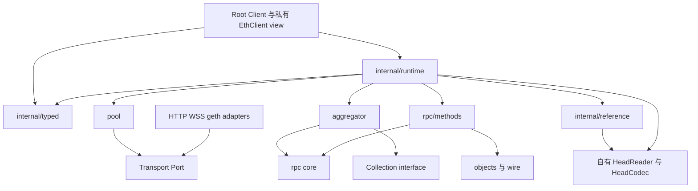
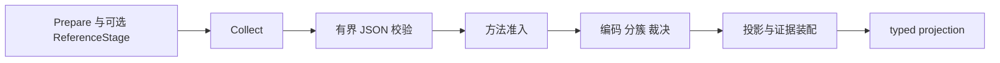

# 代码库拓扑与模块所有权

状态：现行结构约束。本文定义知识归属、依赖和稳定 seam；不维护物理文件迁移计划，不授权改变 quorum、reference 或方法行为。

## 1. 模块地图

| Module | 拥有的知识与入口 | 不应拥有 |
| --- | --- | --- |
| root `ethguard.Client`／`EthClient` view | 公共 API、单次 CallResult、捕获与生命周期；共享一个私有执行 owner | 第二套装配、typed decoder 或方法字段表 |
| `internal/runtime` | 唯一生产 Composition Root；pool、aggregator、method、reference、projector 的组装 | 公共 API、第二套业务规则 |
| `pool` | 固定成员、source 生命周期、健康、调度、fan-out，消费 Transport Port | Ethereum 字段含义、裁决公式 |
| `aggregator` | invocation 顺序、reference／业务轮、收集与证据装配 | 具体 transport、字段语义、schema 解释 |
| `rpc` | Request、Observation、Decision、Policy、通用裁决与 evidence | 网络连接、`rpc/methods` 依赖 |
| `rpc/methods` | 请求语义、admission、比较键、encoder 与 reference 需求的装配、catalog | transport 生命周期、另一套 quorum 循环 |
| `rpc/internal/objects`／`wire` | 对象约束、请求绑定、承诺、规范化、schema 生成类型与字段裁剪 | pool、facade、客户端连接 |
| `internal/reference` | finalized 等候选／确认算法及其 consumer-owned HeadReader／HeadCodec 接口 | 直接依赖 pool、methods 或构造 aggregator／policy |
| `internal/typed` | Value 到公开 Go 类型的唯一生产 projection | source collection、投票、网络取数 |
| `internal/transport` | Port-only 类型、能力与中立 sentinel | 方法 policy、quorum、安全裁决 |
| `internal/transport/{http,wss,geth}` | 原生 HTTP／raw WSS 与显式 geth adapter 的协议和保真 | 把 provider 错误重新解释为业务共识 |
| `internal/subscription` | 流式聚合、source/session 归属、gap／背压与终止 | 复用 unary CallResult 假装流式生命周期 |
| `internal/verification`、`internal/testkit`、`rpctest` | 公开 seam 的黑盒、跨模块和 fixture 验证 | 被生产 Module 反向导入或成为生产事实源 |
| `observe` | 被动事件记录 | retry、调度与安全决策 |
| `cmd`／`examples` | 操作入口、捕获与示例 | 独立实现核心规则 |

`gethcompat` 是调用者显式选择的兼容 seam，不是第二个默认 runtime。其单源 SimulateClient 不产生 EthGuard quorum 或 CallResult 证据；当前依赖边界与完整性缺口见 [兼容政策](go-ethereum-compatibility-policy.md)。

目录必须隐藏实际行为并拥有清楚的 seam；不为视觉分组创建浅层 forwarding package。`rpc/methods` 保持一个生产模块，不因文件数增加就拆成名词包。

### 方法自治组织样板

`transaction_by_hash.go` 与 `transaction_in_block.go` 是当前两个样板：每个文件拥有自己的 RPC 名称、公开业务接口映射、现有 MethodSpec／只读 MethodDescriptor，以及方法特定的准备、完整 key 修正规则与请求绑定。公开 Go 签名仍在 root／EthClient；一个底层 RPC 策略可服务多个公开入口，不为目录整齐复制策略。

`spec_inventory.go` 与 catalog 对全部方法只收集其所属文件给出的定义，不再次展开配置；集中方法名称表已退役，每个 RPC 拼写由其方法文件唯一声明。方法之间不得调用对方的准备／修正函数；共用对象校验和编码直接依赖 `rpc/internal/objects/transaction`，通用 codec 依赖 wire。按方法的白盒测试随同名文件，跨方法输出一致性与公开路径测试仍按既有验证 owner 保留。

本样板只调整知识归属、名称和引用，不增删公开接口、方法集合或兼容规则，不改变 quorum、保护域或证据合同。历史扩展条目另行评审，不借组织整理移除能力。

已确认的后续规则组织为**外层按官方直接 key 分支，内层按该 key 的完整形态／状态分支**。方法文件拥有经审核的整 key 兼容转换和方法接受域；wire 拥有通用 codec、投影及生成结构约束；objects 拥有共享对象一致性和规范编码。内层状态判断不授权嵌套路径或数组元素局部修正，不构成组合注册表；无额外兼容规则的方法不需要空 switch。

状态判定读取原始同源只读上下文，修正写入独立候选；缺失规则与已有 key 去重，每个 key 只处理一次。未命中修正仍须完整校验、编码和比较。当前 PruneMethod 还包含 hex 规范化，消除职责重叠须检查实际实现，不能仅修改归属描述。两 transaction 方法已完成双 switch 收敛；其余方法的全量迁移推进顺序见 [路线图](project-roadmap.md)。

## 2. 依赖与稳定 seam

箭头表示依赖能力或契约，不授权 reference 直接 import pool。生产 `PoolHeadReader`、`MethodHeadCodec`、`ReferenceStage` 与 head services 由 runtime 绑定；root anchor facade 不再自己构造 policy／aggregator。一次移动标签读取只有一个 Invocation 和冻结 Basis，不嵌套启动另一轮顶层 Aggregate。

硬规则：

1. Interface 由消费者定义；Transport／Head-Reading Port 不携带方法 policy 装配。
2. Adapter 负责协议、传输形状和生命周期，不做 admit、quorum、conflict。
3. `rpc` 不导入 `rpc/methods`，不拥有网络 I/O；允许裁决所需的 JSON／wire 处理。
4. pool 不解释 Ethereum 方法参数；aggregator 不解释字段表；生产不导入 verification／testkit。
5. 只有一个 Composition Root 和一个 typed 实现。root 与官方形状 view 不得各自实现一套执行、重试、解析或证据链。
6. geth 的具体 client／rpc 依赖按显式 adapter 与现有静态 interlock 白名单管理；不能从兼容逃生舱推导默认原生 build 已解除限制。

## 3. 单次读取管线

这是概念顺序，不强迫所有方法共享同一物理路径；写入和订阅另有契约。编码先于计票，失败不缩分母；窄键、规范字节与获胜簇检查见 [返回值合同](return-value-design.md)。Corroborated 描述受保护结果的 provider-backed evidence，不是整份上游 JSON、canonical chain 或 finality 的保证。

## 4. 验证与变更边界

跨模块公开 seam 验证归 `internal/verification/{facade,integration}`；实现包保留确需未导出状态的白盒测试，不为迁移制造不合理的测试 adapter。只有形成独立知识所有者时才新增 contracts／scenarios／replay 目录，不为阶段编号永久建目录。

依赖守卫、可替换 Transport／HeadReader、同一 typed 实现服务多个 facade，以及行为回归共同验证拓扑。结构重组不得暗改门槛、保护域、reference 或 transport 语义；不得把 README／路线图／历史决策当运行时注册表。

验证所有权与门禁归 [method-verification-pipeline.md](method-verification-pipeline.md)，当前业务缺口与顺序归 [project-roadmap.md](project-roadmap.md)，外部声明归 [go-ethereum-compatibility-policy.md](go-ethereum-compatibility-policy.md)。旧终审过程、三份草案对照和完成清单由 Git 保留，不再并列维护。
