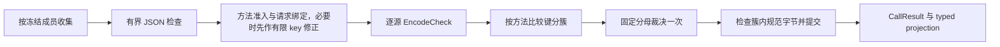

# 返回值：受保护结果与规范编码

状态：现行语义说明。历史阶段计划、已撤销方案和实施日志保留在 Git；本文件不维护任务进度，也不授予新的实现变更。

## 1. 独立合同与语义等价

| 合同 | 回答的问题 | 事实源 |
| --- | --- | --- |
| 官方 wire 合同 | 方法、结果字段、类型、required、nullable 和值约束是什么？ | 固定 execution-apis bundle 与对应版本的协议／方法说明；见 [spec 数据说明](../../internal/spec/README.md) |
| EthGuard 保护合同 | 哪些内容经过请求绑定、内容承诺或跨源比较，可以进入受保护 Value？ | [方法契约](method-contracts.md)、[决策记录](../decisions.md)、方法准入与 encoder |
| 表示合同 | 同一个被接受的值如何编码成确定字节？ | `rpc/internal/wire` 与各对象 encoder；官方生成层见 [wire-codegen.md](wire-codegen.md) |

项目接受政策单独说明哪些非标准拼写可兼容读入，以及哪些官方合法输入因方法语义被拒。它既不改写官方 schema，也不自动形成额外保护。

比较等价关系由方法和字段语义定义，不由 shape 相同推出：大小写、转义、键序可归一；QUANTITY 按数值，DATA 按完整字节。`0x0000` 与 `0xDeadBef` 不因此等价；若另一方法只保护二者共有的业务结论，须明确该结论及输出合同，不能仍将其中一份原始 payload 当作获佐证结果。

**规范编码表示确定性，不自动表示符合完整官方结果 schema。** 在合法对象上增加请求绑定是更深锁定；拒绝部分官方合法输入是接受域收窄；删掉官方 required 字段、输出不允许的 null，则不是原对象 schema 的合法子集。当前实现包含这几种不同情况，不得混称为“比官方更严格”。

公共 RPC 的实际响应有兼容性参考价值，但不是字段规范的来源。保留的 [shapeprobe 归档](../samples/2026-09-26-shapeprobe/README.md) 记录有限日期、端点和请求，不能推出普遍兼容。标准冲突与接受边界由各方法合同维护；receipt 裁决见决策 0068，独立 transaction 的首个实施检查点见 [方法级 key 设计](transaction-semantic-matching.md#12-当前实施检查点)，block 等未随之迁移。

## 2. Value 的含义

已注册方法的 Value 是方法声明的受保护结果，不是代表源原文。它必须来自一份已准入载荷的确定性编码：

- 不把多个来源的字段拼成新对象，不从比较键反序列化来重建回答。
- 比较键覆盖的字段、被请求绑定或已验证承诺约束的字段、按公开规则派生的字段，才有进入保护域的依据。方法必须说明采用了哪一种依据。
- 本地派生值需要与来源声明核对时，先核对；不把错误来源修成正确值后计票。
- 未获保护的内容只进入声明的 Extensions／Diagnostics 或 opt-in 原始证据通道，不借 Value 暗示已佐证。
- 多源 Corroborated 仍是 provider-backed evidence，不是 Ethereum consensus、canonicality、执行有效性或密码学 finality。

“保护域”与“完整官方对象”当前不完全相同。区块 encoder 有意不输出 `size` 和嵌入交易上下文，其中包含官方 required 字段；这是需要评审的兼容边界，不是官方 schema 本身允许省略它们。独立交易与收据又有各自的字段规则，不能把区块的 `from` 排除决定推广到所有对象。

receipt 已采用官方形态与保护闭环：`from`／`effectiveGasPrice` 必须由来源提供并比较；nullable `to`／`contractAddress` 保留缺失、null、地址三个状态；可选非 nullable 字段存在时拒绝 null；`type` 受 byte 约束。`status`／`root` 至少一个存在，同时存在则独立校验、比较并保留。完整日志要求、bloom-log 一致性、请求绑定和零日志 hash 容忍仍按方法规则执行；后者不构成完整父子绑定证明。Geth `types.Receipt` 无 `from`／`to` 字段，完整受保护 wire 信息保留在 `Decision.Value`，不伪造 typed 字段。

## 3. 准入、编码和裁决

- Admit 或 EncodeCheck 失败的来源记 Fault，不贡献支持，仍留在本轮分母。不得先裁决、再删掉失败来源重算门槛。
- 完整区块等方法保留声明的 normalizer key；独立交易的比较与编码使用同一完整候选对象。数量、成功 DATA、feeHistory、logs、accessList 和 receipts 使用各自规范字节。实际装配见生成的 [method-rules.md](method-rules.md)，不在本文复制注册表。
- 获胜簇内支持源的规范字节必须相同。同键却编码不同是保护域／比较键／实现不一致，返回 `ErrMalformedResponse`，不改选某份原文或逐字段投票。
- 非获胜簇的同类不一致只形成 Faults，不否决已经达门槛且自身一致的获胜簇，不触发第二次投票。诊断保留 source ID、长度和摘要，不复制完整 Value。
- Median 和 Local 保持 Selected；未注册 Forward 路径没有受保护声明。不能因编码一致把它们升级为 Corroborated。
- 公开调用失败时，`CallResult` 不交付成功 Value；结果载体、隔离与生命周期以决策 0066 为准，不能套用旧阶段的失败 Value 示例。

字节相等只是必要条件：删掉应保护的字段也能制造相等。验证还必须覆盖字段处置、变异、请求绑定、派生和受保护语义往返，见 [验证管线](method-verification-pipeline.md)。

## 4. 表示与空值

| 类别 | 当前规则／边界 |
| --- | --- |
| QUANTITY | `0x`、小写、无多余前导零、零为 `0x0`；严格数量不把前导零当作另一种合法拼法 |
| DATA | 保留字节长度与前导零；不得把 `0x00`、`0x`、`0x0` 合并。storage word 另要求 32 字节 |
| 地址及对象 | 地址规范为小写；对象按 encoder 的字段顺序紧凑编码，关闭 HTML escaping；键序不表示语义优先级 |
| 官方 Number | 精确保留 JSON 十进制数，界限来自 schema，不经 float64；由生成层处理 |
| 受保护 feeHistory ratio | 仍执行项目 `CanonicalRatio` 的 float64 最短十进制保值 gate；`0.50` 可折合，`0.30000000000000001` 被拒。这是项目接受域限制，不是官方 number 定义 |
| 缺失与 null | 不全局补空值。对象查询合法 null、空数组、字段缺失和显式 null 按具体方法区分；现有 optional 字段的 null→省略例外及其冲突见问题记录。区块 encoder 的 null→省略例外（2026-11-13）：`withdrawalsRoot`／`blobGasUsed`／`excessBlobGas`／`parentBeaconBlockRoot`／`requestsHash` 在官方 schema 为 optional 且 non-nullable，而 geth 头部 marshal 对未设指针字段输出显式 null——这是 pre-fork 区块事实上的 wire 形状，提交时折合为省略，使受保护值成为官方 schema 的合法子集（与 log `blockTimestamp:null`→省略同类） |

标量实现单源为 [wire/encode.go](../../rpc/internal/wire/encode.go)，对象规则单源为对应 `rpc/internal/objects/*/encode.go`。不要在文档再维护一份可独立漂移的字段清单。

## 5. 代表源和证据

代表源是获胜簇中本次捕获成员顺序的第一个来源，不按到达先后或 source ID 排序。对已规范编码的方法，它决定审计锚点，不决定 Value 拼写。

Provenance 的准入证据、withheld 字节和代表源必须同源；不得从簇内其他成员补材料。Provenance 不保存代表源 Raw，也没有为 Raw 设定的字节上限。原始证据的保留预算属于 `CallResult.Uncertain`／source-evidence 通道，不能与此混为一谈。域外字段只有达到动态门槛的单一值才能进入 Extensions，其余为 Diagnostics；它们不成为受保护 Core。

### 数据交付与责任范围

项目不以一个万能 struct 兼容所有 provider 响应。官方定义是受保护结果的语义基准，前置兼容只积累经审核的生态规则；责任边界见 [方法契约](method-contracts.md#前置生态兼容与官方语义检查)。字段未被官方类型或公开 Go 类型表达，不等于它没有交付价值，但也不能因此把它并入受保护 Value。

| 交付通道 | 承载内容 | 责任与条件 |
| --- | --- | --- |
| Value 与 typed projection | 当前方法承诺保护的官方结果及其公开 Go 表示 | Value 沿方法合同准入、比较和编码；typed 可能无法表达其中全部官方信息，不能以 typed 零值或丢字段冒充完整保真 |
| Extensions／Diagnostics | 域外字段的附属比较结果及来源差异 | 按既有附属规则交付，不承诺适配每种厂商字段的业务语义，不把它们升级为官方主结果 |
| CallResult.Uncertain／source-evidence | 按来源保留的原始响应、字段与错误材料 | 按需开启，受现有安全限制、保留预算及截断规则约束；原文不因前置兼容被覆写，不作为主结果合法性的替代依据 |

“用户仍可取得来源提供的值”指通过上述不同形态取得受保护结果、附属内容及已保留的来源材料，不承诺默认、无条件、无限量保存所有原文字节。需要查看域外或无法规范交付的来源内容时，调用者应启用 `WithSourceEvidence` 并配置适当预算；实际丢弃和截断由 `Uncertain` 的记录状态说明。材料保留不足不能改变请求、比较范围、投票资格或门槛。

处于方法承诺保护域内的官方信息不能仅因 Go struct 无法承载，就降为可关闭、可截断的原始证据。域外材料也不能为保留在一个返回结构中而污染官方 Value。多源 RPC 的响应形态差异通过语义规范结果与分通道材料表达，不通过无限扩充一个统一结构消除。

`eth_call` 成功只输出规范 DATA。revert 分开裁决 execution 与 data：缺失/null 对 data 弃权，空字节、具体 hex 与非 hex JSON 是不同断言；未达门槛的 data 不进入 Value。provider code/message 留在 `Decision.Revert` 作为上下文，不拼装固定错误信封，也不声称文案获佐证。当前 `RevertError` 只承接受保护 data，不暴露旧 provider `ErrorCode()`。依据为决策 0039、0052、0054、0061。

传输保真必须按 adapter 区分：历史 geth WSS seam 的 missing/null 折叠不能外推到现行 raw WSS，也不能用 HTTP 证据替代 WSS。具体范围由 [传输契约](transport-contract.md) 和 [WSS 契约](wss-wire-contract.md) 维护。

## 6. 维护边界

当前行为看代码和上述合同；接受／取代的理由看决策 0041–0056、0061、0066。阶段编号、已完成清单、被撤销的 Raw 容量方案和旧 API 示例不再留在现行规范里。需要改变保护域、官方兼容性或接受策略时，先处理 `docs/tmp` 中的问题，再更新实现、消费者与行为验证；本文整理不代替该决策。
