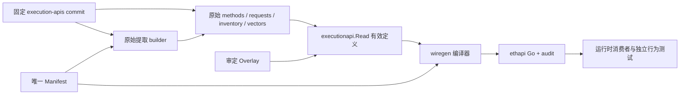

# 官方来源与类型生成合同

维护日期：2026-11-28。本文件拥有来源、Manifest、Overlay、通用编译、审计和隔离升级的工程合同。SDK 用户保证与示例集中在 [ethapi/README.md](../../ethapi/README.md)；方法绑定、密码学承诺及多源裁决仍由各自合同定义。完整生成与真实消费的测试证据分别验收，不能由公开类型已存在推导所有消费者已迁移。

## 来源、契约与单向依赖

`ethapi` 是标准数据、严格构造校验与编解码包，不承载网络调用或 geth 类型。标准接受域来自固定官方定义与显式审定修正；表示政策只处理已通过检查的值。provider 的有限兼容处理实际输入，归入口、方法和共享对象 owner，不能混进标准 Overlay。



Manifest 同时驱动提取和编译，是二者共用的构建输入。`executionapi.ReadOriginal()` 验证原始材料身份；`Read()` 在其上原子应用 Overlay。显式 `ReadOriginalFrom(fs.FS)`／`ReadFrom(fs.FS)` 使用相同装配逻辑处理候选目录，不加载 Manifest，不反读 `types.audit.json`。`LoadManifest` 仅由离线工具和测试消费，没有生产初始化加载路径。

固定 pin `981aa66d79364be8322a9c358aaf0a571cca0873` 的完整库存为 93 个官方方法；当前 Manifest 收录 31 个结果和 51 个 `eth_`／`net_` 请求描述。`net_listening`、`net_peerCount` 和原先遗漏的三个 eth 方法都有该 commit 的官方定义，不存在 supplements／project-contract 例外。`eth_getTransactionByBlockHashAndIndex` 的非 null 子模型复用 `BlockTransaction`，根保留未找到时的 null；不能复制独立 by-hash 查询的 pending 字段修正。

四种状态分开证明：上游存在由完整 inventory 证明；已收录由提取物与 Manifest 证明；已生成由编译产物和 audit 证明；运行时已消费由下游实际方法、对象及 typed 入口行为测试证明。Header 模型和尚未实现的方法可以处于不同状态，不能以强行集合全等掩盖合法差异。

允许的依赖为 `methods/ethobject → ethapi → ethcodec`。wiregen 不导入 methods、执行引擎或客户端，ethcodec 不导入 ethapi。运行期 mask／projection 可以读取有效参考定义，但不把 schema 解释器塞进请求执行路径。生成物不承担投票、信任判断或业务绑定。

## 唯一 Manifest 与忠实编译

[`internal/executionapi/manifest.json`](../../internal/executionapi/manifest.json) 是唯一人写的生成选择和命名合同：

| 字段 | 责任 |
| --- | --- |
| `resultMethods` | 原始结果提取与生成范围 |
| `valueValidationResults` | 选择完整结果根的只读 Go 值验证；必须是 `resultMethods` 的无重复子集，当前仅 AccessList |
| `requestInventoryPrefixes` | 原始请求库存范围；不是 runtime 方法注册表 |
| `requestRoots` | 实际生成的 method／parameter／RFC 6901 子节点，子选择绑定紧凑 schema 摘要 |
| `names`／`titleNames` | 精确来源路径名称与通用标题名称 |
| `aliases`／`fieldOrder` | 显式公开别名和已有编码金标的字段序 |
| `scalarPolicies` | 已审定标量表示政策；不另造 pattern 或值域 |
| `defaultExclusionReason` | 完整上游库存中未收录项的边界说明 |

来源引用统一使用 method、`result`／`request`、参数序号与 `schemaPointer`；审计路径保留真实 composition kind、原始 index 和 JSON Pointer 转义。`inventory.json` 记录固定 OpenRPC 的 `/methods/N` 锚点、结果和参数 schema 摘要，以及完整有序参数描述符摘要，不能仅凭方法名称假定来源位置未变。

Manifest 的未知字段、重复条目、路径丢失／子分支漂移、未命中的命名规则、未用 alias／字段序／表示政策及未声明名称碰撞均使生成失败。公开类型、字段及结果解析入口均检查 Go 标识符碰撞，不以数字后缀解决。schema 去重使用完整约束语义和构造策略；不会将不同 pending／mined 或 request／result 接受域合并。

编译器要求完整、非空的上游 inventory，并用 `requestInventoryPrefixes` 从库存计算期望请求集，与实际 requests 严格互锁；缺失／额外请求、零命中或被其他前缀完全涵盖的冗余前缀均失败。修改 Manifest 范围后必须重新提取，不能让旧库存继续通过生成。

`internal/wiregen` 是唯一离线编译器，`go generate ./ethapi` 与新鲜度门使用同一入口。它使用有序 schema 模型及 Jennifer 结构化输出，保留 required、nullable、组合、对象开放性、精确数值和所有已支持约束。不支持或无法忠实表达的约束直接报错，不能降级为宽松 Go 类型，也不能标记“由运行时保证”后放行。已删除 methods.list、requestRoots 硬编码切片和编译器内手写命名／别名／字段序表。

`ethapi/types.gen.go` 与 `types.audit.json` 都是可再生产物，不是修正入口。普通生成离线运行；同一输入应得到字节一致的 Go 和 audit。来源、Overlay 或 Manifest 变化后都必须重生成并执行独立行为验证。

## 结果值验证试点

当前只生成公开 `ValidateCreateAccessListResult(v AccessListResult) error`，辅助对象验证函数私有。对可成功编码的值，其接受结果等价于 `NewCreateAccessListResult(v.MarshalJSON())`；实现从与 parser 相同的 IR 生成，共用标量谓词和约束输出，只读遍历值，不执行 JSON 往返，也不补字段或改变表示。

验证针对编码后的语义：外层 nil 指针表示省略，指向 nil 的非 nullable 数组编码为 null 而被拒绝，空数组仍为合法 `[]`；nullable 数组的 nil 指针和指向 nil slice 均表示 null。required 的 Go 字段总会被编码，不能从其零值推断原始 JSON 缺失。自由 Text 中的非法 UTF-8 保留既有编码语义；带约束的 Text 在局部副本中按每个非法字节替换为 U+FFFD 后检查，调用方值不变。const／enum 与原 parser 一样选择保留字符串身份的 Text，不因 Address／HexByte 表示折合改变约束判定。

选择根的完整可达图必须受支持：字符串及严格标量、pattern／const／enum、对象 required／optional／nullable／`not.required`、数组 minItems／maxItems。当前 uniqueItems、多个非 null 分支的 union、非字符串标量、字典及保留额外成员的对象会使生成失败；未选择值验证的根仍保持原有生成能力。未来升级触及这些形态时必须明确扩充能力或调整选择，不能静默跳过约束。

AccessList 准备层继续消费 provider 的别名、扩展投影、null 折合和既有报错顺序；根值验证后只编码一次。官方封闭对象不改变准备层允许并投影 provider 扩展的合同。JSON 安全、原始输入身份和业务准入不属于值验证的证明。现场 schema 变异同时验证 New／Validate 和实际 accesslist 消费者；required 改变 Go 字段类型时，旧消费者的编译失败也是必须处理的升级信号。audit 在该结果根记录 `valueValidator`，不扩成全模型 Validate 接口。

## 请求构造与生成能力

`SimulateV1Request`、`BlockStateCall`、`SimulateCall`、`BlockOverrides`、`AccountOverride`、`StateOverrides`、`AccountStorage` 和 `SimulateBlockReference` 由同一有效 schema 生成。嵌套 withdrawal／access-list 使用请求专用模型，避免与既有结果投影的接受策略错误共享。`SimulateCall` 不强行复用结构与约束并不等价的 CallMsg。

已选择的所有请求根（CallMsg、BlockReference、FilterQuery、收据订阅子模型及Simulate的payload／base）统一采用 `strictRequests` 构造策略，模式参与模型去重；开放结果使用声明字段投影，封闭结果同样拒绝未知成员。所有对象按精确 JSON key 取值，不借用 Go struct 解码的大小写宽容匹配。选择清单只决定生成覆盖，不包含RPC业务语义。这里的strict表示忠实检查请求schema，不表示所有对象均封闭：

- 官方 `additionalProperties:false` 的固定对象拒绝未知 key；封闭同型 `patternProperties` 字典要求每个 key 匹配规则并检查对应值。地址／storage-key 字典的 key 保留原始大小写，不合并不同拼写。
- 官方开放的固定对象通过生成的 `AdditionalProperties map[string]json.RawMessage` 保留未声明输入。编码时不得覆盖任何已声明 key，即使该 typed 字段缺失；未知字段不经 float64，也不因字段名仅大小写相似而同时填入另一个 typed 字段。这是请求保真，不改变响应 Value／Extensions 的职责。
- 公开请求构造器在根执行 JSON 安全检查，随后调用生成的私有子 parser，不为每个子字段重复整树准入。独立调用子模型的公开构造器同样有根检查；extras 编码拒绝不安全原文和声明字段碰撞。

通用生成能力包括 string／bool／精确 number 的标量 enum、对象 `not:{required:[...]}`、封闭同型 pattern 字典，以及数组 minItems／maxItems／递归精确 uniqueItems。唯一性上下文递归保留字符串的原始语义值，避免把大小写不同的合法地址或其他不同字符串规范化后误判重复；数字仍按精确 JSON 数值比较。结果投影遇到可能丢未知成员、从而破坏唯一性的开放对象组合时明确生成失败，不改写既有结果投影政策。其他 not 形态、对象／数组 enum、异型或开放 pattern 字典、尚未实现的组合附加约束均在生成期报错，不能静默丢失约束。能力来自通用建模和 Jennifer 输出，不按 RPC 修改 schema AST，也不引入运行时 schema 解释器。

固定来源的 base 有五个 anyOf 分支：quantity、tag、裸 hash、仅含 quantity blockNumber 的封闭对象、含 blockHash 与 optional requireCanonical 的封闭对象。对象 blockNumber 不接受 moving tag；省略／nil 默认 latest 是方法行为，不把 null 加入官方 union。保留官方分支顺序，前导零及全零 32-byte hash 必须往返不变，不能被当作数量缩短。

95 个官方 payload 与 base 均有独立往返验证；其中 31 个顶层 RPC 错误的请求也合法，不能当作 schema 拒绝样例。unknown-account／block-override-key 官方请求仍按开放 schema 保留输入，后续方法／上游错误语义不由生成层改写。

## 显式标准勘误与外部审计

| 层 | 修改对象与时机 | 归属 |
| --- | --- | --- |
| 标准勘误（Spec Errata） | 构建／初始化固定参考数据时，对特定请求或结果 schema 应用审核过的 JSON Patch | `internal/spec/errata/*.json` 与 `internal/executionapi` |
| 前置生态兼容 | 实际请求或来源响应，按已知字段及同源上下文形成候选 | 公开入口、各方法及共享对象 owner |
| 通用生成器 | 忠实翻译有效 schema，支持标准关键字 | Jennifer generator，不包含方法语义修正 |
| 附属及原始证据 | 原始来源字段、差异和预算内材料 | Extensions／Diagnostics／source-evidence，不改写官方主值 |

Overlay 分两类。`kind: "patch"` 保留三份定向 RFC 6902 结构修正，声明目标 method／part／parameter、局部 `before` 与 `after` 守卫；`kind: "data-pattern"` 用一条有限规则声明 `fromPattern`／`toPattern`、精确目标及各节点的非 pattern 身份。每份规则都有 ID、理由、HTTPS 依据和退出条件，依赖由 `dependsOn` 明示；文件名仅用于定位。

DATA 规则当前包含 23 个根的 69 个节点，继承结构修正之后的明确位置。该数量是当前来源的测量结果，不是固定框架常量。目标为空、重复或身份变化均失败；新增字段不会因为看起来像 DATA 就被自动修改。`ValidateSelectedData` 另遍历全部已选有效 schema：未审阅的旧 `^0x[0-9a-f]*$` 节点必须失败。确有非 DATA 语义时，只能在同份规则的 `exceptions` 中登记精确路径、完整节点身份、理由和退出条件；过时或未用例外失败。

`json-patch/v5` 禁用负索引、隐式创建祖先和忽略缺失 remove。一个审定 patch 内的有序父子操作按 RFC 6902 执行；跨 Overlay 写入同路径或祖先路径必须有显式依赖。依赖缺失／循环、重复 ID／目标／应用及不完整元数据均失败。整根 replacement 被拒绝，修正必须声明实际受影响子路径。

`EvaluateOverlays` 用于升级诊断，逐目标给出 `applicable`（局部前置仍成立）、`already-satisfied`（可退休候选）或 `review-required`（路径／身份／结构冲突）。一条 DATA 规则可以部分待应用、部分已满足；不能自动退休整条规则或推断不同正则语义等价。正常 `Read()` 和生成拒绝未清理的退休候选与任何冲突；失败不返回部分有效 Bundle。

统一 SOURCE 固定版本与原始字节身份，Overlay 不再重复手写每个 commit 和整根输出 hash。应用账本记录规则定义摘要、原始根、前序修正后的实际输入根、输出根、目标节点前后摘要和具体修改路径。局部语义守卫允许无关格式变化，原始字节变化仍进入升级 diff 和来源记录；摘要不能冒充独立语义正确性证据。原始向量和 `ReadOriginal` 从不偷偷应用修正。

独立 query 勘误仅给 blockHash／blockNumber／blockTimestamp／transactionIndex 的值增加 null 分支，四项仍 required，原非 null 约束保留；前三项和额外 timestamp 的依据分别记录在勘误中。不修改完整块内嵌交易合同，不自动派生缺失字段；pending 上下文一致性与 by-hash 的有限派生由方法拥有。旧生成器内 pending 特判已退出。

## 官方形态与项目规范字节

有效 schema 定义字段、可选分支和输入接受域；representation policy 定义已通过检查的值如何表示，两者不得混为一谈。Go 名称与表示政策的映射可人工维护，但数值模型的增减和值域必须由 schema 的 type/pattern/minimum/maximum/const 驱动，不能由映射表另造约束。

- 字符串只解码一次，先按有效 schema 检查原始字符串，再应用显式表示政策。Quantity、Hash、DATA、Bloom、BlockNonce、StorageKey、DecimalString 已有严格拼写，直接保留合法值；不再调用宽容 codec 后检查规范输出。DATA 保留空值、字节长度及前导零，完整字节限制来自显式 DATA 勘误。
- Hash、Bloom、BlockNonce 的 native parser 对精确模式 `^0x[0-9a-f]{64}$`、`^0x[0-9a-f]{512}$`、`^0x[0-9a-f]{16}$` 使用共享固定宽 ASCII 检查。Quantity／Quantity64／Quantity256、Data、Address、HexByte、StorageKey、DecimalString 也仅在 pattern 精确匹配时绑定 `ethcodec` 严格 ASCII 原语；其它模式保留正则。该优化不改变 JSON 解码、null、错误包装或合法值表示，近似／未来模式不能借 Go 类型名称套用检查。const／enum、递归 uniqueItems 与 `keepStrings` 继续由原生成约束执行；性能分阶段与验收见 [性能验证](performance-verification.md)。
- Address 的官方 pattern 允许混合大小写 hex digits、要求小写 `0x` 前缀；通过后可输出小写。HexByte 仅接受 `0x` 后 1–2 个小写 hex 字符，通过后折合一个冗余前导零：`0x04` → `0x4`、`0x00` → `0x0`；`0x4A`、`0X4a`、符号及三个 hex 字符均拒绝。
- string const／enum 以及递归 uniqueItems 上下文保留原字符串语义值；即使 pattern 对应 Address，也不先改大小写而破坏字面常量、枚举或唯一性。普通字符串的 JSON 转义不属于语义值，编码可采用统一形式。
- 真正多非null的oneOf／anyOf也递归保留已验证字符串：转换不能使原本唯一匹配的输入在输出后命中另一分支。私有parser传递 `keepStrings`，保持Address／HexByte等公开类型；单个nullable包装只传递已有上下文。独立子模型构造器从无组合上下文开始，其合法表示可能与经组合根构造不同，两者都须满足相应schema。
- 官方 Number 只接受完整 JSON number，精确保留任意十进制值，不经 float64；minimum/maximum 来自各 schema 的真实边界，由精确比较执行。`0.30000000000000001` 不因 float64 精度损失被拒绝。负零规范为 `0`，科学计数法与 fixed 输出的选择只影响拼写，不限制数值域；不会展开巨大指数。
- 数字 const 按精确 JSON 数值比较。即使其 Go 表示为 int，`3`、`3.0`、`3e0` 也都匹配常量 3，再赋值为 3；字符串 `"3"` 和精确不等的十进制数不匹配。
- `CanonicalRatio` 仍是项目受保护 feeHistory encoder 的额外规范化政策：`[0,1]` 内按 Go 最短 round-trip 输出，并拒绝改变精确十进制原值的输入。官方生成 Number 不调用它；两者不能共用一个“是否合法”的结论。
- Quantity256 上限为 64 个 hex digits，即 32 bytes；Bloom 为 512 个 hex digits，即 256 bytes。
- 固定字符串 pattern 约束输入；当前 net_version 的官方模式允许十进制 `"0"`，拒绝 `"000"`、`"+1"` 和负数；对象／方法层的接受政策另列，不能称为官方限制。
- 字段顺序采用确定的文档顺序，已有受保护编码器金标的对象族保留显式顺序表。紧凑 JSON、无 HTML 转义。
- 封闭结果拒绝未声明字段；开放结果只投影声明字段。运行时消费者需接收 provider 扩展时，由明确的前置 owner 提取官方字段，原始扩展继续留在来源证据中，不以标准构造通过代表扩展已验证。

现有兼容由入口明确选择字段再调用 `ethcodec.FoldHexSpelling`：它只折合单个已知 hex JSON 字符串的前缀及字母大小写，保留长度、前导零；非法值原样交给后置检查。Header／Receipt 依据生成模型的字段标签提取官方字段，Syncing 的共享 owner 供方法和 typed 入口复用。AccessList 的 error、Simulate 的 error.message 等自由文本不应用该操作；不建立任意对象或未知字段的递归修正规则。

Block body、直接Transaction及Simulate结果的已有兼容由 `internal/ethobject/hexcompat` 共用：仅为显式生成模型建立有限已知字段树，折合白名单hex类型，保留Text／Number及未知内容。AccessListItem／Withdrawal／Log的前置字段投影明确登记；不接受外部规则或运行时schema。HexByte另执行合法值的最短表示，交易按明确type选择字段树，防止将typed交易的v规则误套给legacy的Quantity。原始来源保持不变，字段与内容检查仍由后置owner承担。

交易对象的 canonical 准备已经通过 wiremask 完成比较字段投影和 hex 折叠，因此直接把裁剪结果交给生成构造器，不再重走 hexcompat 字段树。生成模型成功选中分支后，对 typed V／YParity 和 7702 授权项 YParity 作最短 HexByte 表示；legacy V 仍是 QUANTITY，其他分支不表达的开放成员按原比较投影回填。生成构造器和独立 typed raw 入口的合同不变。裁剪结果可能因 HTML 转义超过原输入大小，进入生成构造器前仍检查该结果的 JSON 预算。

Block 的 header/body 合成和生成构造只由 `internal/ethobject/block` 维护，protected Encode 与 direct raw 解码共用。完整准入保存其已经检查的规范 Block，订阅交易交付复用该产物；这省去重复编码，不省略 shape 检查，也不把交付时的私有交易解析提前加入方法准入。原始解码与已准入投影保持独立信任入口，没有跳过验证的通用开关。

既有 generic `Call` 也能触达 Block 的 reference-only／header-only 分支，不能把它们写成仅内部调用。仅 number/hash 的参考值不经过完整 Block 根；完整 header 缺少 body 时按 Header 合同处理；携带 body 的路线才执行 Block 构造与对应承诺检查。消费审计分别标明这些范围，不声称所有 block 返回路径都具有完整 Block schema 保证。

公开Filter入口保留其已承诺的大小写兼容，按固定字段及数组层级处理冻结快照；调用方额外成员保持。CallMsg、Simulate原始请求及直接标准构造器遵守有效schema，不因旧构造器曾隐含接受大写或非规范十进制而扩张前置规则。直接Go赋值后Marshal仍不等于通过构造检查。

### 缺失与 null

required 与 nullable 是两个独立维度。非 nullable 值拒绝 JSON null；nullable 值保留 null；optional nullable 字段区分缺失与显式 null，不以省略制造相等。

nullable root 的 null 表示 nil。数组空值 `[]` 与 nullable root 的 `null` 保持不同。receipt 的 `to:null` / `contractAddress:null` 在官方类型和受保护 encoder 中均保留；缺失、null 与地址值参与不同的比较，见决策 0068。

### Composition 与分支

模型保留真实的 oneOf/anyOf 及原始分支身份；每个分支必须执行其全部支持的类型和值约束。分支不能仅因映射到同一 Go 类型而被合并。

oneOf 要求恰好一个分支匹配，包括全部 null 匹配；anyOf 要求至少一个匹配，并按声明顺序选择规范表示。含显式 null 分支的 anyOf 将 JSON null 统一表示为空选择，即使更早的嵌套分支也接受 null；编码仍为 null，其余输入按首个成功分支表示。生成层与离线 conformance 都保留 oneOf／anyOf 的接受域区别。`BlockTransactions` 为 anyOf，空数组可合法匹配多个分支。

开放结果投影可能删除未知字段，从而让另一 oneOf 分支开始匹配，或让 anyOf 改选更早分支。`internal/wiregen/projection.go` 在生成期检查这种变化：oneOf 的可投影分支须对全部竞争分支证明稳定，anyOf 须对更早分支证明稳定。证明只采用互斥 JSON 类型、双方必填且保留的不同精确标量 const／已支持的单值 hex pattern，或数组元素类型互斥；空数组投影不变。无法证明时以双方来源路径和分支序号报 unsupported，不生成隐含失真的模型。请求模式保留开放对象的额外成员，无需该投影证明；其他约束仍由普通 walker 检查。

固定来源中的交易 type、Simulate status／error code，以及 object／null、object／boolean 和 hash-array／object-array 组合满足上述证明。该检查不进入库的运行时，也不是通用 schema 求解器。新增组合若不能可靠表达，须扩展有独立反例的生成能力或明确拒绝，不能丢失约束后选择首个成功分支。

`eth_getLogs` 的原始 schema 使用 hashes/logs 两个数组分支的 oneOf，`[]` 会同时匹配两者。`getlogs-empty-array-overlap.json` 只将该方法 result 的 oneOf 改为 anyOf，保留当前公开双分支模型和非空分支约束，使空结果合法；不修改原始 bundle 或通用 oneOf 规则。生成层能解析 hash 数组，不代表受保护方法接受该分支；生产方法仍只接受 logs。非法混合数组、null 和非数组不因该修正成为合法结果。

## 命名、版本与新鲜度

path override、title override 和稳定回退仅决定 Go 名称，不得改变标准语义。路径保留 composition kind 与原始 index；不保留旧合成路径兼容别名。语义 fingerprint 排除 title/description，但包含约束、nullable、composition 与子值语义。

公开模型及其可达分支须固定语义名称，不能把遍历顺序触发的 `2` 等碰撞后缀作为长期接口命名政策。独立交易查询与区块内嵌交易因有效 nullable 合同不同，应分别命名、保持各自约束；去重不能抹掉这一区别。当前查询union及五分支已固定为 `Transaction`、`SetCodeTransaction`／`BlobTransaction`／`EIP1559Transaction`／`AccessListTransaction`／`LegacyTransaction`；内嵌区块使用 `BlockTransaction` 及 `Block` 前缀五分支。显式名称按完整语义fingerprint预登记，冲突直接失败，不以自动后缀掩盖。旧数字后缀名已替换，属于公开生成类型名变更。`SimulateBlockReference`保留为同源`BlockReference`的生成别名及构造器shim。

扩充请求生成覆盖时，根选择必须明确 method、参数序号及必要的 schema 子路径，保留完整来源定位和所选节点摘要；只生成所需子模型，不把有重叠分支的整个订阅参数 union 当作某一业务查询。当前requestRoot已支持RFC 6901 JSON Pointer；收据订阅选择`eth_subscribe.params[1]/oneOf/2`，固定所选紧凑schema摘要，路径／分支漂移失败。源路径、节点摘要、稳定名称与别名进入生成审计，并有独立验证；调用方不手工裁剪schema。

返回模型接入前还须核对该方法实际提交的 Value 能否满足目标有效 schema。生成模型已存在不代表当前受保护投影字段齐全；不得从代表源 Raw 补必填字段、制造零值或放宽生成校验来接通迁移。模型的结构检查、对象内部完整性、方法请求绑定与裁决信任分别由现有 owner 承担；共享对象检查须覆盖查询、订阅事件和同源 Pull，不能仅凭查询 admission 已接通便删除订阅 decoder 的校验。

生成时要求两个bundle的版本与 `spec.Version()` 一致；生成文件在包初始化时检查版本。这是生成期检查和运行时init guard，不是编译期校验，也不可能由测试函数抢先于init执行。

`ethapi/types.audit.json` 由同一次编译产生，记录来源与完整库存、Manifest 摘要、Overlay 定义和逐目标应用、有效根摘要、结果入口、公开模型／别名及全部来源路径、标量严格校验与表示政策、节点完整约束和对象构造政策。模型去重不能使其他 method/path 消失；数组、required、null、组合、const／enum、数值范围和对象开放性也可追溯。

覆盖记录只陈述编译器可证明的上游存在／收录／生成事实，不导入 runtime 生成 `consumed: true`。真实消费由下游合同互锁测试、对象测试和 typed 入口测试补证；字段级消费与完整根消费不能混写。方法绑定、32 字节 storage 要求、内容承诺及 protected 编码政策是额外业务约束，不是生成器缺失的 schema 约束。

审计不写时钟、临时绝对路径或机器差异。生成 Go 摘要证明身份，重新生成证明新鲜度，执行正反例证明被测行为；三者不能相互代替。未选择请求根、顶层 RPC 错误及缺少官方向量的方法如实保留覆盖边界。

CI和release门将生成Go及audit写入临时文件并分别与已提交产物比较，防止同版本schema／生成器修改后忘记重生成。audit包含生成Go摘要；新鲜度不能单独证明语义正确，版本字面量、源码片段或函数数量测试也不能代替独立行为验证。

## 独立验证

1. 原始官方 schema conformance 使用未修改来源与原始 .io，和应用勘误后的有效合同分开报告。
2. 所有方法共用向量枚举；原始成功 result 经生成入口往返，核对声明内容、输出有效性、幂等及 presence。顶层错误不进 result parser，未覆盖错误 schema 明确列出。
3. 受保护 parity 与生成往返分开；每侧必须独立成功，双方拒绝不能算 parity 通过。Block／Transaction／Receipt 等的对象保护与规范 schema 分别验证。
4. 独立负例覆盖 const／pattern／bounds、optional 出现值、非 nullable null、精确数、分支重叠和不支持形态。现场生成／编译／执行 parser，不用另一套共享实现产生全部预期。

CallMsg 与 Simulate 请求根执行 JSON 安全检查后使用私有子 parser；直接调用子模型公开构造器也有根检查。直接构造 Go 值的使用者仍须满足不变量；入口按合同重新验证，Marshal 不重复整树解析来冒充准入。union 额外验证选中分支数量和 nullable 状态，开放请求 extras 编码验证原文安全及 key 碰撞。

直接结果构造器不统一承担 JSON 大小、深度和重复 key 准入；实际方法／对象消费入口按既有合同执行 `jsonsafe`。该安全边界和 schema 忠实性分别验证，不把本轮生成修复表述为扩大了所有公开构造器的安全保证。

## 固定来源与向量

固定来源 [`981aa66d79364be8322a9c358aaf0a571cca0873`](https://github.com/ethereum/execution-apis/tree/981aa66d79364be8322a9c358aaf0a571cca0873) 已包含 blobVersionedHashes 数组、prevRandao bytes32、balance-only overrides、VM 消息和 Payload 对象类型的官方修复。仍存在的来源缺口独立处理：

- `transaction-query-pending-context.json`：仅为独立 transaction query 的四个 inclusion 字段保留 required-but-nullable；不影响完整区块内嵌交易。
- `simulate-block-state-calls-items.json`：将 array 上原有 block execution properties 原样移入 object items；不添加客户端数量限制、默认值或时间规则。生成的强类型请求消费修正后的结构，方法语义检查保持独立。
- `getlogs-empty-array-overlap.json`：只解除该方法空数组的 oneOf 重叠，不改变方法的 logs-only 保护政策。
- `data-whole-bytes.json`：依据 EIP-1474 的完整字节定义，将 DATA 的 `^0x[0-9a-f]*$` 显式修正为 `^0x([0-9a-f]{2})*$`。一份规则覆盖当前 14 个结果根、9 个请求参数根、69 个节点，应用于上述结构勘误之后；保留空 DATA 和前导零，不影响 StorageKey、HexByte 或 QUANTITY。原始 schema 仍保留其允许半字节的缺口，独立 conformance 不偷偷套用该修正。

该来源新增官方 block/Simulate slotNumber，byte pattern 与 net_version 十进制范围也有变化。业务保护域与生成接受域分别审阅；完整区块仍按既有 header 哈希及内容承诺检查。HexByte 先检查原始 lowercase/non-empty 约束，再折合合法前导零；已有消费者的大写拼写兼容在显式前置处理处保留。`net_version` 的实际方法根现与生成结果共享非负十进制校验，允许零；具名历史兼容保留 `+`、冗余前导零和负零，负非零值明确拒绝。时间默认和递增关系留在方法语义，不塞入 schema 勘误。

## 可复现同步与候选验收

`specsync` 统一调度来源获取、按 Manifest 提取、原始向量核验、Overlay 诊断、双向 diff、候选生成和隔离验证。三种输入互斥；失败不切换模式或回退联网：

```sh
go run ./cmd/specsync -commit <full-commit> -out /tmp/candidate
go run ./cmd/specsync -upstream-dir <clean-official-checkout> -out /tmp/candidate
go run ./cmd/specsync -openrpc <file> -vectors-dir <dir> -source <material-source.json> -out /tmp/candidate
```

联网模式只获取显式完整 commit 并运行其官方 specgen。离线 checkout 模式核对完整 HEAD、官方 origin 和无改动输入，使用本地已有工具链与依赖。离线材料模式验证 OpenRPC 摘要、向量库存和每个文件的原始摘要，不运行上游构建。其 metadata 为 `MaterialSource{source,vectors}`；成功准备候选后输出的 `material-source.json` 和 `openrpc.json` 可直接用于再次离线复现。

来源可信度与 SHA 一致性分开。官方材料模式只接受当前工作区已审定的来源／构建／向量身份；新官方 commit 通过联网固定来源或核验本地 checkout 进入。任意本地文件附自报 SHA 不能提升为官方来源。`category: fixture` 可演练抽取、诊断、真实生成和编译，永不具有生产发布资格；无参生产 `Read()` 拒绝把 fixture 当内嵌官方来源。

工具链可通过 `-go-tool <installed-go-executable>` 显式指定；默认依次检查可用的本地 GOROOT 与 PATH，验证安装目录和实际 Go 版本，再使用具体编译器路径。发布使用 `-trimpath`，运行时 GOROOT 为空也能发现已安装的 Go，不能依赖构建机器路径。报告记录实际工具链，联网官方构建的 SOURCE 同样记录实际编译器版本。所有 Go 子进程固定 `GOTOOLCHAIN=local`；离线进程另设 `GOPROXY=off`、`GOSUMDB=off`、`GOVCS=*:off`。缺失工具链或依赖明确失败；不自动下载工具链。普通 `go run` 启动器仍须由执行环境预先准备，已发布的 specsync 二进制直接执行不依赖该启动器。

`-out` 必须是全新仓外目录。活动 VERSION、原件与生成物从不临时替换；候选写入 staging 后整体移入输出目录，失败保留 `report.json` 并标未就绪。`-prepare-only` 只形成来源和诊断，`ready` 必须为 false，不能冒称已编译／测试。

默认验证复制当前实际工作区（含未提交文件，排除 Git 内部状态），检测复制期间源文件变化，再在同一快照替换候选 spec／Manifest／Go／audit。生成 Go 的 init 版本互锁与候选 VERSION 保持同一快照。生成成功后执行全仓 `go test -p 2 ./...`、`go vet ./...` 和 `go build ./...`。固定版本来源断言与历史 oracle 随升级审阅更新；工具不保证任意新 commit 无人审阅即可通过。fixture 仅执行真实生成和 `go build ./ethapi`，消费测试明确标为不适用并说明非官方身份。

输出目录包含 `spec/`、`generated/`、`workspace/`、`snapshot.json`、`logs/`、原始输入材料和 `report.json`。报告绑定前后来源、Manifest、完整源码快照和产物摘要，附真实命令、状态、日志文件及摘要。`ready=true` 表示适用的本地候选验证成功；`publishable` 仍为 false，代码审阅与外部 replay 另行提供，不自动提交、推送或虚报 replay。

```sh
go run ./cmd/specdiff -before-dir internal/spec -after-dir /tmp/candidate/spec -json
go run ./internal/wiregen -source-dir /tmp/candidate/spec -manifest internal/executionapi/manifest.json -out /tmp/types.gen.go -audit-out /tmp/types.audit.json
```

`specdiff` 同时比较 result 和 request：方法增删、参数数量／顺序／名称／required、完整 schema 关键词和对象字段顺序。原始字节摘要另行保留，不能用 canonical 排序吞掉输出顺序变化。`-check` 是无差异门，出现来源字节变化即失败；历史 `conformancePassed`／`replayPassed` 布尔迁移记录仅为历史证据，不作为新升级验证入口。

`specsync` 汇总原始定义差异、逐目标 Overlay 状态、有效定义差异，以及生成公开类型／签名和 Go／audit 产物差异。原始 conformance 按原始 schema 报告；有官方缺陷时如实列出，不能借有效修正伪造原始通过率。当前 226 个 `.io` 文件包含 227 次 RPC 交换，其中 185 个成功结果和 42 个顶层错误；文件数与交互数不混用。

## 维护与实际消费验证

来源、Manifest 或编译能力改变时，按上述工具准备候选，再执行该层独立测试和已有 CI／release 门禁。单元测试覆盖 Overlay 局部漂移／退休／失败原子性、目标外旧 DATA 逃逸、请求参数变化、离线模式互斥、错误摘要、缺失向量和 fixture 来源隔离；真实 fixture 用实际 `-trimpath` 发布形态的 specsync、不同 VERSION 和完整快照执行生成与编译，同时验证空 GOROOT 下的工具链发现与活动版本隔离。

运行时方法必须先执行已声明有限兼容，再使用对应生成方法根或生成器绑定的严格原语。比较键、typed uint64 范围、storage 固定字节宽度及内容承诺保留各自责任，不能因为都检查同一个字符串就机械删除。`ethcodec` 不反向调用 ethapi；生成模型和实际消费者共享严格原语，而宽松兼容有具名入口。

实际消费由 [`standard_consumption_test.go`](../../internal/methods/standard_consumption_test.go) 枚举实际注册读方法并执行 CompilePlan 正反例，再用独立有效 schema 检查成功输出；typed 范围与对象内容关系由各入口合同测试补证。兼容标识集中在 `ethcodec/compatibility.go`，分别覆盖 wire hex 大小写、仅小写前缀的 DATA、peerCount 前导零以及 net_version 历史非负等价拼写。

这轮明确的接受域收紧包括：`net_version` 拒绝负非零值；FeeHistory 拒绝缺失／null 的 required `gasUsedRatio`，拒绝 `reward` 内 null 行。FeeHistory 可选字段的整体 null-as-absence、旧成员拼写和无关字段投影保留；这些属于具名兼容，不能伪称官方 schema 本身允许。`+1`、冗余零与负零等非负等价 net_version 拼写仍可前置转换，typed 可表示范围另验。

AccessList 与 FeeHistory 在有限兼容后执行完整结果根；AccessList 使用上述生成值验证，FeeHistory 保持 JSON 根构造。共享 Log 的 `Validate` 仍是旧方法必填／字段校验，`EncodeOne` 在构造 canonical 候选后执行完整 `NewLog`；GetLogs 的 Encode 路线使用逐项 Log 构造器和数组业务合同，不宣称执行了完整 GetLogs 方法根；不能只调用 Validate 就宣称完整 Log root 消费。交易、区块、收据及 nullable/数组外层分别按实际入口核对，不以“用了字段类型”替代 root，也不把 reference/header 范围写成完整 Block。

更多方法限制和发布行为说明仍归 [方法合同](method-contracts.md)、[返回值合同](return-value-design.md) 和 [路线图](project-roadmap.md)。新增收紧必须在消费审计与发布说明显式列出。

后续 ASCII 快路径、解析复用、IPC 与独立 ethadapter 按各自验证推进。标准流水线稳定只是它们的输入条件，不代表这些后续工作已经完成。
